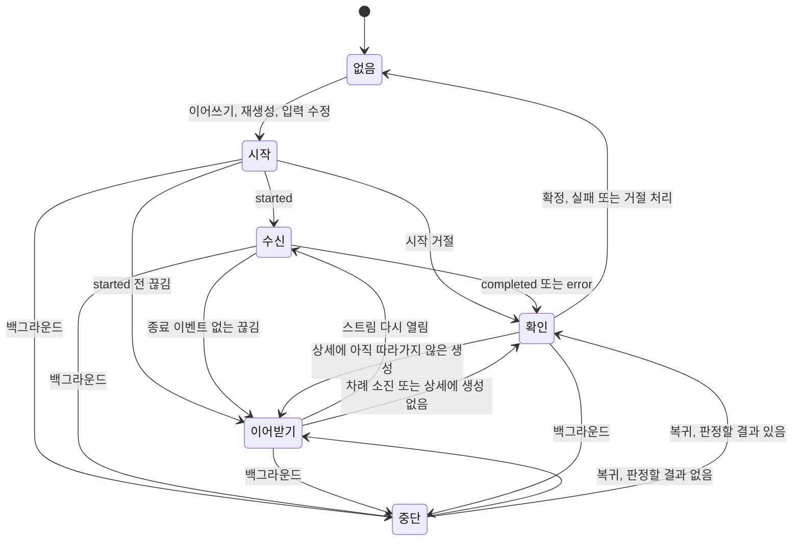

# 4-4 실행: iOS

 

### 4-4-1 요청과 SSE 해석

| 단계 | 실행 |
|---|---|
| 요청 | 이어쓰기, 재생성과 입력 수정은 POST, 이어받기는 본문 없는 GET. `Accept: text/event-stream`. 공용 요청 계층의 공통 헤더와 인증 경계(선제 재발급, 401 뒤 재발급 한 번과 재전송 한 번) 사용. `X-Manyak-App-Version` 없음 |
| 본문 | 이어쓰기 `userInput`, `lastTurnId`, `realtimeImage`. 첫 턴의 `lastTurnId`는 키를 생략하지 않고 null로 씀. 선택 값을 생략하는 기본 인코딩과 별개로 이 필드만 명시 인코딩 재생성 마지막 `turnId`, `realtimeImage`. 사용자 입력을 다시 보내지 않음 입력 수정 `turnId`, 앞뒤 공백을 뺀 `userInput`, `userSource: typed`, `realtimeImage` `realtimeImage`는 요청 스냅샷 값을 항상 명시 |
| 수신 | `URLSession.bytes`로 응답을 받아 상태와 `Content-Type`을 확인한 뒤 바이트를 순서대로 읽음. 서드파티 SSE 라이브러리 없음 ([I-090](DECISIONS.md#i-090)) |
| 시간 제한 | 새 바이트가 60초 동안 없으면 읽기 시간 초과. 연결 전체 시간 상한 없음. 일반 요청의 시간 설정은 바꾸지 않음 ([I-092](DECISIONS.md#i-092)) |
| 줄 나누기 | 바이트에서 LF, CRLF, CR로 줄을 직접 나눈 뒤 줄마다 UTF-8로 해석. 빈 줄을 건너뛰는 줄 단위 도우미에 의존하지 않음. 청크 경계에서 한글이 깨지지 않음 |
| 필드 | `:`로 시작하는 줄은 무시. `event:`는 이벤트 이름, `data:`는 데이터 줄로 쌓고 여러 줄이면 줄바꿈으로 이음. 콜론 뒤 공백 하나만 제거. `id`, `retry`와 모르는 필드는 무시 |
| 이벤트 경계 | 빈 줄마다 쌓인 데이터가 있으면 이벤트 하나를 넘긴 뒤 이름과 데이터를 모두 비움. 데이터가 없어도 이름을 비움. 이름 없는 이벤트는 버림. 빈 줄 없이 EOF가 오면 덜 끝난 이벤트를 버림 |
| 반영 | token은 화면 갱신 한 번에 모아 반영할 수 있음. 도착 순서를 바꾸지 않고 끊기와 취소에서 아직 반영하지 않은 조각은 버림 |
| 종료 | completed 또는 error를 넘기면 더 읽지 않고 요청을 취소해 연결을 닫음 |

| 이벤트 | 해석 |
|---|---|
| `started` | JSON의 `generationId`를 보관하고 진행 조각 초기화. 없거나 해석하지 못하면 생성 ID를 모르는 채 수신 계속 |
| `token` | 데이터가 JSON 객체면 `text` 문자열, JSON으로 해석되지 않으면 데이터 원문. `text`가 없는 객체와 그 밖의 JSON 값은 버림 |
| `character_image` | JSON의 `name`과 `imageUrl`이 모두 비어 있지 않은 문자열일 때만 도착 위치의 이미지 조각. 그 밖은 버림 |
| `completed` | 완료. 데이터는 렌더 기준으로 쓰지 않음 |
| `error` | 명시적 실패. `code`와 `message`는 화면 문구와 분기에 쓰지 않음 |
| 그 밖의 이름 | 버리고 계속 읽음 |

 

### 4-4-2 SSE 실패 변환

| 시점 | 입력 | 변환 | 수신 결과 |
|---|---|---|---|
| 응답 전 | `CancellationError`, `URLError`의 취소 | 변환 없음 | 취소 |
| 응답 전 | 그 밖의 `URLError`. 시간 초과 포함 | `Network` | 시작 거절 |
| 응답 | 401, 403 | 인증 경계의 재발급과 재전송 뒤에도 같으면 `Unauthorized`, `AccountSuspended` | 시작 거절 |
| 응답 | 그 밖의 2xx 아닌 상태 | `Server(status, code, requestId)`. 오류 본문 해석이 실패해도 상태 유지 | 시작 거절 |
| 응답 | 2xx이지만 `Content-Type`이 `text/event-stream`이 아님 | `Serialization` | 시작 거절 |
| 연 뒤 | `completed` | 없음 | 완료 |
| 연 뒤 | `error` | 없음 | 명시적 실패 |
| 연 뒤 | `URLError`, 60초 읽기 시간 초과 | 변환 없음 | 끊김 |
| 연 뒤 | 종료 이벤트 없는 EOF | 없음 | 끊김 |
| 연 뒤 | 화면 이탈이나 백그라운드에 따른 취소 | 변환 없음 | 취소 |
| 연 뒤 | 해석하지 못한 이벤트 | 없음 | 그 이벤트만 버리고 계속 |

취소는 실패로 바꾸지 않으며 토스트, 분석 이벤트와 non-fatal 보고가 없다. 시작 거절은 상태(있을 때)와 `DomainError`를 함께 넘기고 채팅방은 상태로만 나눈다. ([I-100](DECISIONS.md#i-100), [IOS 기반 네트워크 요청](../../../../platform/CLIENT/IOS/3-EXECUTION.md#3-2-네트워크-요청))

 

### 4-4-3 이어받기와 확정

| 단계 | 실행 |
|---|---|
| 따라가기 | 첫 연결 또는 새 라운드부터 종료 사건까지 수신. 재연결은 첫 재연결 포함 최대 4회. 첫 재연결은 즉시, 이후 실패 뒤 1초, 2초, 4초를 주입한 시계로 기다림 |
| 차례 | 직전 연결에서 받은 생성 ID가 있으면 그 ID로 재연결 GET. 직전 차례가 `started` 없이 실패했거나 ID를 모르면 상세의 `generatingTurn.generationId`를 조회한 뒤 GET. 상세에 생성이 없으면 결과 불명 |
| 실패한 차례 | 재연결 GET의 시작 거절(404, 503, 네트워크 등), 끊김, 상세 조회 실패. 다음 차례로 넘김 |
| 결과 | 완료, 명시적 실패, 시작 거절(첫 연결만), 결과 불명(차례 소진 또는 상세에 생성 없음) |
| 확정 | 시작 거절 402를 뺀 모든 결과에서 상세 조회. 상세에 아직 따라가지 않은 생성이 진행 중이면 같은 생성 작업에서 새 차례 예산의 새 라운드로 이어받음. 차례를 소진한 생성이 상세에 그대로 진행 중이면 다시 따라가지 않고 결과 불명으로 끝냄 |
| 완료 | 상세 성공 프레임에 확정 턴으로 교체, 목록 변경 신호, 추천 생성 조건 확인 |
| 명시적 실패 | 상세 표시, 낙관적 버블과 진행 조각 제거, 이어쓰기는 보낸 입력을 입력칸에 복구, 재생성은 이전 본문과 이미지 복원, 입력 수정은 숨긴 턴과 고치던 입력 복원, 실패 토스트 |
| 시작 거절 402 | 상세 조회 없이 입력 되돌리기와 이프 부족 시트. 재생성은 기존 본문, 입력 수정은 숨긴 턴과 고치던 입력 유지 |
| 시작 거절 409 | 입력 되돌리기 후 상세. 생성 중이면 이어받고 아니면 최신 턴 표시. 토스트 없음. 재생성은 기존 본문, 입력 수정은 숨긴 턴과 고치던 입력 유지 |
| 그 밖의 시작 거절 | 입력 되돌리기 후 상세. 생성 중이면 이어받고 아니면 실패 토스트. 재생성은 기존 본문, 입력 수정은 숨긴 턴과 고치던 입력 유지 |
| 결과 불명 | 이어쓰기는 전송 시점보다 확정 턴이 늘었으면 완료, 늘지 않았거나 같은 생성이 여전히 진행 중이면 실패 토스트. 재생성은 확정 본문 표시. 입력 수정은 대상 턴이 상세에 없으면 완료, 남아 있으면 실패 토스트. 이어쓰기 실패는 낙관적 버블을 지우고 보낸 입력을 입력칸에 복구하되 그사이 입력칸에 새 입력이 있으면 덮어쓰지 않음 ([I-101](DECISIONS.md#i-101)) |
| 확정의 상세 실패 | 따라가기와 같은 횟수와 간격(즉시, 1초, 2초, 4초로 최대 4회)으로 다시 조회하고 진행 블록과 잠금 유지. 소진하면 결과 불명과 시작 거절은 실패 토스트, 완료와 명시적 실패는 방 오류 상태와 다시 시도 ([I-092](DECISIONS.md#i-092)) |
| 이탈 | Store 작업 취소로 수신만 정리. 실패 토스트와 실패 계측 없음 |
| 재진입 | 새 Store의 상세 조회. 생성 중이면 생성 ID를 아는 라운드로 이어받음 |
| 목록 | 완료로 끝난 이어쓰기, 재생성, 입력 수정과 포크 201에 변경 신호. 가려진 목록도 조용히 갱신 |
| 포크 | POST 201의 `id`로 이동 Effect. 앱 타깃이 같은 탭 스택의 원래 방 위에 채팅방 라우트를 쌓음. 실패는 현재 방 유지와 토스트 |
| 모델 조회 | 진입 시 목록과 상세 조회. 모델 목록 실패가 방 열기를 막지 않으며 다시 시도할 때 재조회 |

입력 되돌리기는 이어쓰기의 낙관적 버블을 지우고 보낸 입력을 입력칸에 되살리는 것이다. 서버 저장 결과를 우선하며 복구를 위해 새 이어쓰기나 과금을 시작하지 않는다. ([공통 4-1-3](../4-1-CONTRACT.md#4-1-3-상세와-오류의-해석), [공통 4-4-2](../4-4-EXECUTION.md#4-4-2-이어받기와-종료))

 

### 4-4-4 백그라운드와 복귀

앱 타깃이 장면 단계를 채팅방 Store에 전달한다. `background`가 되면 진행 중 생성 작업을 끊고 `background`를 벗어나면 복귀를 시작한다. 알림 센터, 제어 센터와 앱 전환기 진입처럼 `inactive`에만 머무는 전환은 끊지 않는다. ([I-091](DECISIONS.md#i-091), [I-093](DECISIONS.md#i-093))

| 상황 | 처리 |
|---|---|
| 끊는 범위 | 시작, 수신, 이어받기와 확인 단계의 작업 전체. 스트림 요청, 재연결 대기와 판정용 상세 조회를 함께 취소 |
| 중단에 보관 | 생성 종류, 요청 스냅샷, 대신하는 턴 ID, 전송 시점 확정 턴 수, 아는 생성 ID, 확인 중이던 결과. 메모리에만 둠 |
| 중단 중 화면 | 받은 진행 조각, 낙관적 사용자 버블, 진행 중 숨김과 입력 잠금 유지. 반영하지 않은 조각만 버림. 토스트와 실패 계측 없음 |
| 없음 단계 | 끊을 것이 없음. 복귀 때 상세를 다시 읽지 않음 |
| 복귀, 판정할 결과 있음 | 같은 결과로 확인 단계를 다시 실행 |
| 복귀, 그 밖 | 새 차례 예산의 이어받기 라운드. 아는 생성 ID가 있으면 즉시 재연결 GET, 없으면 상세로 진행 중 생성 조회 |
| 생성이 아직 진행 중 | `started`부터 다시 받아 진행 조각을 처음부터 재구성. 대기 높이와 읽던 위치는 최소 높이로 유지 |
| 생성이 이미 끝남 | 종료 후 5분 보관 안이면 재생된 completed 또는 error로 확정. 지났으면 404 뒤 다음 차례의 상세로 결과 불명 판정 |
| 생성 ID를 받기 전에 끊김 | 상세에 진행 중 생성이 있으면 이어받고 없으면 결과 불명 판정. 서버가 요청을 받기 전이었다면 생성과 과금이 없고 이어쓰기는 실패 안내 |
| 재생성 판정 | 생성 ID를 알면 재생된 종료 이벤트로 성공과 실패를 구분. 모르면 공통 이어받기 한계대로 확정 본문 표시 |
| 중복 전송 방지 | 중단과 복귀 판정이 끝날 때까지 전송, 재생성, 입력 수정과 포크 잠금 유지. 복구를 위해 POST를 다시 보내지 않음 |
| 이프 | 끊기, 재연결과 복귀 확인은 새 생성과 과금을 시작하지 않음. 차감, 환불과 체험 복원은 서버 저장 결과가 기준이며 클라이언트가 계산하거나 되돌리지 않음 |
| 복귀 중 다시 백그라운드 | 진행 중인 복귀 작업을 끊고 같은 보관 값으로 다음 복귀에 다시 시작 |
| 일반 요청 | 추천 생성, 포크, 모델과 설정 변경, 삭제와 공유 발급은 끊지 않음. 중단으로 실패하면 각 요청의 실패 결과 |
| 프로세스 종료 | 보관 값이 사라짐. 다음 실행은 방을 열지 않고 방에 다시 들어오면 재진입 규칙 |
| 목록 | 목록 Store는 복귀 때 조용히 다시 조회하고 기존 목록 유지. 실패는 안내 없이 기존 목록 유지 |
| 계측 | 끊기와 복구는 분석 이벤트와 non-fatal 보고 없음. 복구 판정으로 실패 토스트를 띄울 때만 `client_chat_streamError_shown` |

보관 기간, 재연결 계약과 연결 종료 뒤 생성 지속은 서버 계약을 따르고 결과 판정은 공통 요구사항을 따른다. ([BACKEND 4-2-13](../../BACKEND/4-2-CONTRACT.md#4-2-13-생성-스트림-재연결), [공통 2-2-3](../2-2-REQUIREMENTS.md#2-2-3-생성-실패와-복구), [IOS 기반 백그라운드](../../../../platform/CLIENT/IOS/2-STATE-MANAGEMENT.md#2-3-백그라운드와-프로세스-종료))

 

### 4-4-5 안내, 입력과 키보드

| 작업 | 실행 |
|---|---|
| 투어 판정 | 기기 기록, 0턴과 생성 여부 검사, 200ms 뒤 재확인. 현재 스텝과 계측은 Store |
| 투어 배치 | 대상 버튼 좌표를 채팅방 좌표계로 모으고 같은 화면 계층 맨 위에 덮개. 덮개가 열린 동안 뒤 화면은 터치와 VoiceOver 탐색에서 제외하고 가장자리 밀기 뒤로가기를 막음 ([I-094](DECISIONS.md#i-094)) |
| 이미지 예약 | 정상 이어쓰기 완료에서 늘린 횟수가 2이고 이미지가 꺼져 있으면 예약. 입력 잠금 해제 후 500ms 대기 |
| 예약 경합 | 다음 전송, 재생성과 입력 수정 시작에 취소, 종료 후 재대기 |
| 이미지 안내 표시 | 설정 시트가 다 올라온 뒤 시트 내용 위 덮개. 행 좌표로 하이라이트를 맞추고 강조한 스위치가 실제 설정을 바꿈. 안내 동안 시트의 끌어내리기와 바깥 탭 닫기를 막음 ([I-097](DECISIONS.md#i-097)) |
| 안내 닫기 | 켜기, 딤과 확인은 안내 상태만 종료. 퇴장 모션 뒤 딤과 카드를 지우고 시트 닫기 잠금 해제 |
| 초점 | 작성 버튼 탭은 입력칸 초점을 빼앗지 않음. 칸을 비활성화하기 전에 남은 다음 칸 또는 이전 칸에 초점 이동 |
| 키보드 위 배치 | 입력 영역은 키보드 안전 영역을 따라 키보드 위에 붙고 대화 영역 높이만 줄어듦 |
| 읽던 줄 유지 | 키보드나 입력 영역 높이가 바뀌면 대화 영역 높이 변화만큼 스크롤 위치를 옮겨 보던 줄을 제자리에 둠. 생성 중과 편집 중에는 멈춤 |
| 키보드 닫기 | 본문 빈 곳 탭, 전송 잠금과 모드 교체. 그 탭은 헤더를 전환하지 않음. 끌어 스크롤로는 닫지 않음 |
| 헤더 | 자식이 처리하지 않은 탭만 전환. 탭 시작 때 키보드가 열려 있으면 전환하지 않음. 헤더 높이가 글자 크기로 바뀌면 대화 위 여백을 다시 맞춤 |
| 턴 확인 창 | 다시 생성과 입력 수정은 생성 중이 아니고 아는 잔액이 비용에 모자라지 않을 때 열고, 모자라면 확인 없이 이프 부족 시트. 클릭 이벤트는 확인 전 버튼 시점 |
| 편집기 초점 | 편집기가 그려질 때 입력칸에 초점, 커서는 끝 |
| 편집기와 키보드 | 편집 중에는 읽던 줄 유지를 멈추고 키보드 높이가 바뀔 때마다 편집기 전체(입력칸과 버튼 행)가 키보드 위에 보이게 스크롤 |
| 삭제 | 알림창 확정 뒤 Store 잠금과 진행 표시. 204와 404는 성공, 그 밖은 잠금 해제와 토스트 ([I-095](DECISIONS.md#i-095)) |
| 공유 | 발급 성공 후 메뉴를 닫고 닫힘이 끝난 뒤 시스템 공유 시트에 안내 문장과 웹 링크([3-3-2 시트, 알림창과 뷰어](3-3-LAYOUT.md#3-3-2-시트-알림창과-뷰어)). 링크는 빌드 구성의 웹 주소와 `/share/{shareId}` ([I-096](DECISIONS.md#i-096)) |
| 피드백 | `platform: IOS`, `appVersion`은 마케팅 버전. 앞뒤 공백을 뺀 `body`, 비어 있으면 null인 `email` ([I-099](DECISIONS.md#i-099)) |

 

### 4-4-6 이미지와 앵커

| 구성 | 실행 |
|---|---|
| 허용 주소 | IOS 기반의 스킴, 호스트와 경로 검사. 통과하지 못한 주소는 요청하지 않음 |
| 파서 | 공통 저장 마커 규칙. 장면 경로는 대사 라벨 없이 장면 이미지 |
| 이미지 로드 | `ManyakDesignSystem`의 Nuke 이미지 컴포넌트. 수신 즉시 4:3 영역 예약, 실패하면 그 블록만 제거 |
| 뷰어 | Nuke가 준 원본 크기로 맞춤 영역을 계산하고 현재 확대와 이동을 거꾸로 적용해 그림 밖 탭 판정. 크기 미확인은 그림 없는 영역 |
| 닫기 | 배경 탭은 떼는 즉시, 두 번 탭 대기는 그림 위 탭만 |
| 상세 장면 이미지 | 뷰어만 열고 인물 이미지 클릭 이벤트는 보내지 않음 |
| 스트림 앵커 | 헤더 위 여백을 뺀 콘텐츠 시작부터 대화 영역 끝까지 패드 높이 계산. 키보드와 글자 크기로 대화 영역이 바뀌면 다시 계산 |
| 재생성과 입력 수정 위치 | 목록의 AI 안내와 프롤로그 항목 수 반영. 입력 수정 중에는 대상 턴 뒤를 목록에서 빼고 계산 |
| 첫 조각 | 로딩 페이드 종료와 본문 교체. 본문이 자랄 때까지 측정한 최소 높이 유지 |

표현과 복구 결과는 앞 단계에 정의한다. ([3-3](3-3-LAYOUT.md), [IOS 기반 이미지](../../../../platform/CLIENT/IOS/3-EXECUTION.md#3-4-이미지), [공통 4-4](../4-4-EXECUTION.md))
