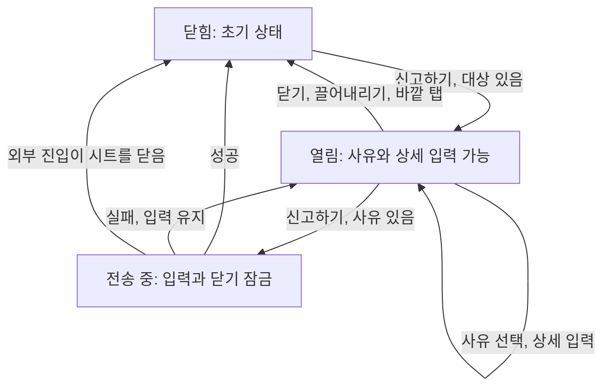

# 4-3 상태 관리: iOS

기준: [구성](4-2-COMPONENT-ARCHITECTURE.md).

 

### 4-3-1 상태와 전이

각 화면 Store의 State가 신고 상태를 가진다. `StoryReportController`는 상태를 따로 보관하지 않고 전이 결과와 결과 Event만 돌려준다. 신고 상태는 테마와 글자 크기 변경에서 유지하고 프로세스 종료 뒤 복원하지 않는다.

| 전이 | 조건과 결과 |
|---|---|
| 열기 | 대상 storyId가 있을 때만. 연 순간의 storyId를 신고 상태에 고정하고 `client_report_sheet_opened` |
| 사유와 상세 | 전송 중이면 무시. 상세는 UTF-16 단위 500을 넘는 부분을 오류 없이 마지막 온전한 글자 뒤에서 자르고 한글 조합 중인 글자를 깨지 않음 ([I-160](DECISIONS.md#i-160)) |
| 제출 | 대상과 사유가 있고 진행 중 제출 작업이 없을 때만. 전송 중으로 바꾸고 `client_report_submitted`를 보낸 뒤 요청 |
| 성공 | 초기 상태. 짧은 토스트 “신고가 접수되었어요” |
| 실패 | 전송 중만 해제하고 사유와 상세 유지. `client_report_failed`와 짧은 토스트 “신고를 접수하지 못했어요” |
| 닫기 | 전송 중이면 무시. 아니면 초기 상태 |
| 외부 진입 | 외부 진입이 시트를 닫으면 전송 중이어도 초기 상태. 진행 중 요청은 신고 제출기가 끝까지 보내고 결과는 토스트로만 알림. 이후 화면이 스택에서 빠져 화면 Store가 사라져도 같음 |

글자 수 표시는 상세의 UTF-16 길이와 500을 보인다. 전송할 때 공백과 줄바꿈뿐인 상세는 null로, 그 밖의 문자열은 그대로 보내며 `has_detail`은 변환 뒤 상세가 있는지다. 상세 원문은 분석에 보내지 않는다.

400, 403, 404, 네트워크와 그 밖의 실패는 같은 실패 전이로 처리하고 `error_type`은 `DomainError` 종류 문자열이다. 신고 결과의 401과 403으로 세션을 끝내지 않는다. 제출 작업은 앱 수명의 신고 제출기가 실행하며 화면 이탈과 스택 재구성에서 취소하지 않는다. 결과 토스트와 `client_report_failed`는 화면 Store가 사라져도 제출기가 낸다. 세션 종료는 진행 중 제출을 취소하며 취소는 실패 토스트와 분석 이벤트를 내지 않는다. ([I-162](DECISIONS.md#i-162)) ([IOS 기반 요청과 취소](../../../../platform/CLIENT/IOS/3-EXECUTION.md#3-1-요청과-취소), [관측](../../../../platform/CLIENT/IOS/3-EXECUTION.md#3-5-관측))
