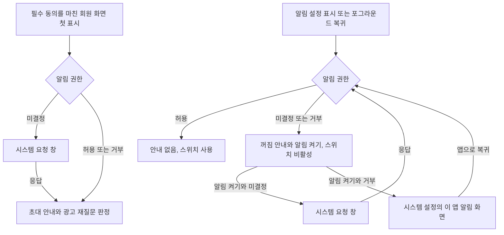

# 3-2 화면 흐름: iOS

기준: [공통 흐름](../3-2-INTERACTION-FLOWS.md), [iOS 목적지](3-1-INFORMATION-ARCHITECTURE.md).

 

### 3-2-1 열람과 복귀

| 진입 | 복귀 |
|---|---|
| 마이에서 공지 목록 | 마이 탭 루트 |
| 목록에서 공지 상세 | 공지 목록 |
| 알림함에서 공지 목록, 공지 상세, 스토리 상세, 이프 충전 | 알림함 |
| 알림함에서 알림 설정 | 알림함 |
| 외부 진입의 공지 상세 | 공지 목록, 이어 홈 탭 루트 |
| 알림함의 제작 목적지 | 복귀 없음. 제작 탭 루트를 선택하고 목록을 즉시 새로고침. 이미 제작 탭이어도 다시 읽음 |

푸시 탭과 앱 열기 링크는 [공통 UI IOS 외부 진입](../../../../ui/IOS/3-2-INTERACTION-FLOWS.md#3-2-3-외부-진입) 흐름으로 목적지를 연다. 목적지 탭의 스택을 루트부터 다시 구성하므로 같은 상세를 두 번 쌓지 않는다.

 

### 3-2-2 권한과 기기 알림 안내

1. 권한 응답이 끝나기 전에는 초대 안내와 광고 재질문을 띄우지 않는다. 시스템 요청 창 위에 앱의 시트를 겹치지 않는다.
2. 알림 설정은 화면이 나타날 때와 포그라운드 복귀 때 권한을 다시 읽어 안내와 스위치 상태를 바꾼다.
3. 처리 결과 알림창을 닫을 때 권한이 허용이 아니면 기기 알림 꺼짐 안내를 토스트로 보인다.
