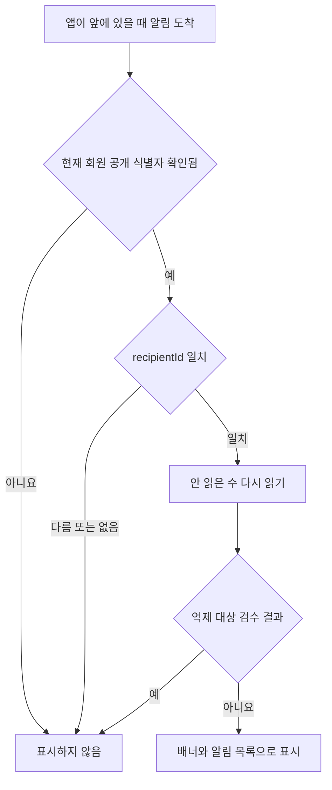

# 4-4 실행: iOS

기준: [iOS 연동 계약](4-1-CONTRACT.md), [iOS 상태](4-3-STATE-MANAGEMENT.md).

 

### 4-4-1 조회와 읽음

- 메인 셸이 처음 나타날 때, 하위 화면에서 탭 루트로 돌아올 때와 포그라운드 복귀 때 공지 첫 페이지와 안 읽은 알림 수를 다시 읽는다. 같은 조회가 진행 중이면 새로 시작하지 않는다. 앱이 앞에 있을 때 현재 회원의 알림을 받으면 안 읽은 수만 다시 읽는다.
- 공지 목록은 커서를 이어 붙이며 상세 성공이 읽음 기록을 추가한다. 상세 404는 기록하지 않는다.
- 알림 목록 조회와 읽음 요청은 actor 하나에서 순서대로 실행해 이전 조회 응답이 읽음 표시를 되돌리지 않게 한다. 한 건은 결과와 관계없이 이동하고 모두 읽음만 실패 때 두 분류 목록과 수를 복원한다.
- 공개 제한 알림의 허용된 deepLink `/studio`는 제작 탭으로 이동하고 목록을 갱신한다. storyId가 함께 있어도 스토리 상세로 바꾸지 않는다.

 

### 4-4-2 APNs 등록과 권한

1. 앱 타깃은 실행할 때마다 Firebase를 초기화한 뒤 APNs 등록을 요청한다. 등록은 알림 권한과 관계없이 요청하고 받은 기기 토큰을 `ManyakNotification`에 넘긴다. 등록 실패는 푸시만 받지 못하게 하며 다음 실행에서 다시 요청한다.
2. `ManyakNotification`은 기기 토큰을 Firebase Messaging에 넘긴다. Firebase Messaging은 기기 토큰을 받은 뒤에 FCM 등록 토큰을 주며 토큰이 생기거나 바뀌면 갱신을 알린다.
3. 필수 동의를 마친 회원 화면이 실행에서 처음 나타나면 앱 타깃이 권한 상태를 읽는다. 미결정이면 알림 표시와 소리를 함께 요청하고 응답을 받은 뒤 권한 단계를 끝낸다. 미결정이 아니면 요청 없이 끝낸다. 임시 허용(묻지 않고 알림 센터에만 조용히 전달하는 방식)은 요청하지 않는다. ([I-143](DECISIONS.md#i-143))
4. 알림 설정의 알림 켜기는 미결정이면 같은 요청을, 거부면 시스템 설정 앱의 이 앱 알림 화면을 연다. 화면이 나타날 때와 포그라운드 복귀 때 권한을 다시 읽는다.

권한 상태는 알림 표시가 허용인지로만 판정하고 서버 수신 동의와 같은 값으로 저장하지 않는다.

 

### 4-4-3 토큰 등록과 삭제

1. 등록은 회원 세션과 필수 동의 완료를 확인한 뒤 시작한다. FCM 토큰 조회와 갱신 알림을 앱 수명 등록기의 같은 직렬 경로로 처리한다.
2. 조회 중 세션이나 동의가 바뀌면 취소하고 요청 직전에 `SessionGate`의 세대를 다시 확인한다. 같은 세션 세대에서 성공한 같은 토큰은 다시 보내지 않으며 새 토큰과 새 세션은 등록한다.
3. 네트워크 실패와 5xx는 다음 포그라운드 복귀, 다음 실행 또는 토큰 갱신에서 다시 시도한다. 400은 재시도하지 않는다. 403은 세대를 확인하는 세션 종료 경로에서 정지 계정 종료로 넘긴다. 401 재발급은 공용 인증 경계가 처리한다.
4. 사용자 로그아웃은 세션의 쓰기 차단 전에 등록기를 차단하고 진행 중 등록이 끝나기를 기다린 뒤 등록한 토큰이 있으면 현재 FCM 토큰으로 서버 삭제를 시도한다. 토큰 조회와 삭제를 합쳐 3초 안에 끝나지 않으면 기다리지 않고 종료를 계속한다. 탈퇴는 서버가 탈퇴 처리에서 회원의 토큰을 모두 지우므로 서버 삭제를 시도하지 않는다. 재발급 실패, 정지와 저장 실패로 끝나는 종료는 서버 인증을 쓸 수 없어 서버 삭제를 시도하지 않는다. ([ACCOUNT iOS 중앙 로그아웃과 복구](../../../ACCOUNT/CLIENT/IOS/4-4-EXECUTION.md#4-4-3-중앙-로그아웃과-복구), [BACKEND 기능 요구사항](../../BACKEND/2-REQUIREMENTS.md#2-2-기능-요구사항))
5. 모든 종료의 회원 저장소 정리에서 알림 정리 항목이 Firebase Messaging의 FCM 토큰을 3초 안에서 삭제하고 알림 센터의 이 앱 알림을 모두 지운다. 토큰 삭제가 실패하거나 시간을 넘기면 기기 토큰 삭제 미완료 표시를 남기고 정리는 성공으로 끝낸다.
6. 실행과 포그라운드 복귀 때 회원 세션이 아니고 미완료 표시가 있으면 기기 토큰 삭제를 다시 시도한다. 삭제가 성공하거나 다음 회원의 등록이 성공하면 표시를 지운다. ([I-145](DECISIONS.md#i-145))

서버 삭제 성공과 관계없이 앞 표시 판단과 탭 수신자 확인을 유지한다. 기기 토큰을 지우면 이전 토큰으로 보낸 알림은 기기에 도착하지 않고 서버가 발송 결과로 무효 토큰을 정리한다. ([무효 토큰 삭제](../../BACKEND/4-2-CONTRACT.md#4-2-7-무효-토큰-삭제))

 

### 4-4-4 수신과 표시

앱이 백그라운드이거나 종료된 동안 받은 알림은 시스템이 서버가 실은 내용으로 표시하며 앱 코드가 개입하지 않는다. 앱이 앞에 있을 때는 알림 센터 위임 객체가 표시 직전에 아래 순서로 판단한다. 판단은 메모리의 현재 회원 값과 검수 화면 관찰 값만 쓰고 네트워크나 회원 확인을 기다리지 않는다. ([I-144](DECISIONS.md#i-144))

- 현재 회원 공개 식별자는 회원 세션이고 프로필이 도착했을 때만 확인된 것으로 본다.
- 억제 대상은 `STORY_MODERATION_COMPLETED` 중 해당 제출본 결과를 기다리는 화면이 보이는 동안이거나 같은 제출본의 같은 결과를 화면에 보여 준 뒤 2분 안인 알림이다.
- 실행과 포그라운드 복귀 때 알림 센터에 남은 이 앱의 알림을 읽어 `recipientId`가 현재 회원 공개 식별자와 다르거나 없는 알림을 지운다. 회원 세션이 아니면 모두 지우고, 회원 세션이지만 식별자가 아직 확인되지 않았으면 확인된 뒤에 지운다.

 

### 4-4-5 탭 진입

- 앱 타깃은 앱 실행이 끝나기 전에 위임 객체를 알림 센터에 지정해 앱 종료 상태에서 누른 알림도 받는다.
- 위임 객체는 알림 응답에서 `type`, `recipientId`, `deepLink`를 읽어 앱 수준 외부 진입으로 넘긴다. 보류, 소비, 수신자 비교와 이동은 [푸시 진입 실행](../../../../ui/IOS/4-4-EXECUTION.md#4-4-1-앱-열기-링크와-푸시-진입)을 따른다.
- deepLink가 없거나 허용 URL로 해석되지 않으면 홈이다. `type`과 식별자로 목적지를 대신 정하지 않는다. ([I-147](DECISIONS.md#i-147))
- `recipientId`가 없으면 다른 회원의 알림과 같게 홈으로 보낸다.
- 알림을 누른 순간과 알림함 카드를 누른 순간 [알림 열기 이벤트](../../../../reference/ANALYTICS.md#4-2-21-알림-열기-계획knk-1927)를 보낸다. 로그인 전이거나 다른 회원이라 홈으로 가도 보내며 deepLink나 UTM이 없으면 보내지 않는다.

 

### 4-4-6 동의

- 첫 선택 동의 허용은 서비스 값을 조회하고 광고만 켠 전체 교체 저장 뒤 처리 결과를 보인다. 저장과 처리 결과가 진행 중인 동안 권한 요청과 초대 안내를 시작하지 않는다.
- 재질문은 권한 단계, 필수 동의와 초대 안내가 끝난 뒤에만 연다. 질문 단계의 차례, 알림 권한 허용과 서버 marketingPush false를 모두 확인한다.
- 첫 거절 뒤 회원 화면이 처음 그려지는 프로세스 실행을 세어 세 번째부터 질문 대상으로 삼는다. 두 번째 거절과 허용은 닫힘 단계로 저장한다. 답한 뒤 기록하고 저장 실패는 시트를 유지한다. 회원 세션이 아니게 되면 준비 상태를 초기화해 같은 프로세스의 재로그인도 판정한다.
- 처리 결과의 일시는 의사 표시 시점의 기기 시각이며 재질문과 설정이 같은 알림창을 쓴다.
