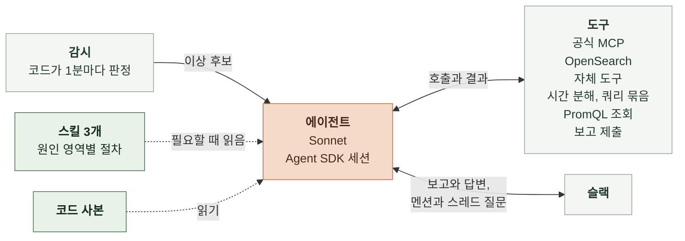

# 1. 배경

이 문서는 장애 진단 에이전트가 해결하려는 문제와 에이전트에 맡길 역할을 정한다.

진단과 대화는 같은 에이전트가 담당한다. 감시와 슬랙 연결은 모델을 쓰지 않는 코드다.

 

### 1-1 도메인

관측은 서비스의 현재 동작을 외부에서 파악하는 일이다.

| 자료 | 내용 | 저장 위치 |
|---|---|---|
| 로그 | 요청 완료, 외부 호출, 오류 같은 사건 한 건 | OpenSearch 로그 인덱스 |
| 트레이스 | 요청 하나가 서비스와 DB를 거치며 쓴 시간 구간 하나를 스팬이라 부름 | OpenSearch 스팬 인덱스 |
| 인프라 메트릭 | 서비스, DB, 캐시, 로드밸런서의 1분 단위 수치 | CloudWatch |
| 앱 메트릭 | 서비스가 직접 내보낸 내부 수치 | Prometheus |
| 확장과 경보 이력 | 오토스케일링이 태스크 수를 바꾼 기록과 경보 상태 변화 | Application Auto Scaling과 CloudWatch 경보 |

인프라 메트릭과 확장, 경보 이력은 AWS에서 운영하던 부하 테스트 환경의 자료다. 현재 운영 환경은 호스트 한 대에서 돌아 이 자료가 없다. 서비스와 DB의 상태는 앱 메트릭과 로그로 본다.

마냑의 각 서비스는 컨테이너로 실행되고 PostgreSQL과 Redis를 쓴다. 채팅 한 턴은 백엔드가 받아 턴 실행기에서 차례를 기다린 뒤 AI 서버를 호출하고 그 결과를 DB에 저장한다.

 

### 1-2 현재 업무와 문제

운영자는 트레이스, 로그, 메트릭을 각각 열어 시각을 맞춰 대조한다.

| 부하 테스트에서 찾은 병목 | 드러난 모습 | 원인 |
|---|---|---|
| 채팅 턴 큐 대기 | 동시 사용자 50명에서 턴 응답 p95 48초 | 턴 실행기가 태스크당 4개만 동시에 실행해 나머지가 큐에서 대기 |
| 동시 턴 상한 재도달 | 동시 사용자 400명에서 큐 대기 p95 5~9초 | 동시 턴 상한 64에 이르렀지만 CPU 기준 오토스케일링이라 백엔드가 늘어나지 않음 |
| AI 서버 CPU 포화 | AI 서버 CPU 평균 65~74%이며 순간 100% | 평균이 확장 기준 70% 근처를 오르내려 확장 조건을 채우지 못함 |
| DB CPU 포화 | 동시 사용자 200명에서 RDS CPU 82~90% | 스토리별 누적 턴을 매 요청 합산하는 쿼리가 채팅 수에 비례해 느려짐 |

| 문제 | 사례 |
|---|---|
| 오류가 없는 장애를 놓침 | 채팅 턴 큐 대기는 오류 없이 지연만 늘어 Sentry가 알리지 않음 |
| 확장 정책이 장애를 가림 | 동시 턴 상한과 AI 서버 CPU 병목에서 오토스케일링과 경보가 동작하지 않음 |
| 대조에 시간이 듦 | 진입 요청의 지연을 하위 스팬으로 나누고 자원 메트릭과 확장 이력을 같은 시각에 맞춰 매번 직접 대조함 |

 

### 1-3 목적과 범위

장애 진단 에이전트는 운영 관측 자료를 감시해 장애를 찾는다. 문제와 발생 위치, 제안 조치를 근거와 함께 슬랙으로 보고한다.

| 구분 | 내용 |
|---|---|
| 대상 서비스 | 마냑 서비스에 묶인 값은 설정으로 받아 설정만 바꾸면 다른 서비스에도 연결할 수 있음 |
| 에이전트의 역할 | 이상 구간 탐지와 장애 판정 영향 범위, 원인 가설, 근거, 제안 조치 보고 코드와 인프라 저장소를 읽어 원인이 된 코드와 설정의 위치 찾기 슬랙 스레드 질문에 답하기 |
| 운영자의 역할 | 보고 확인, 스레드 질문, 슬랙 멘션으로 진단 요청 조치를 정하고 실행하기 |
| 범위 밖 | 파일 수정, 명령 실행, PR 생성 같은 조치 실행 Sentry와 Langfuse 자료 |

 

### 1-4 주체

| 주체 | 설명 |
|---|---|
| 운영자 | 마냑 백엔드 개발자 장애 대응을 겸함 |
| 에이전트 | 상시 실행되는 프로그램 |
| 관측 저장소 | 1-1의 자료를 담은 저장소 |
| 슬랙 | 알림 채널 |
| 코드 저장소 | 각 서비스의 코드 저장소와 인프라 저장소 |

 

### 1-5 공통 용어

| 용어 | 의미 |
|---|---|
| 이상 신호 | 지연, 실패율, 오류 로그, 자원 사용률 중 하나가 정해진 조건을 넘은 1분 구간 |
| 이상 후보 | 이상 신호가 이어져 코드가 진단을 요청한 구간 장애 여부는 미확정 |
| 운영자 요청 | 운영자가 슬랙에서 에이전트를 멘션해 보낸 진단 요청 |
| 진단 요청 | 이상 후보와 운영자 요청을 함께 부르는 말 진단 한 건의 시작점 |
| 장애 | 사용자 요청이 지연 기준을 넘거나 실패한 구간 |
| 진입 스팬 | 외부 요청을 처음 받은 서비스의 스팬 요청 한 건의 전체 시간 |
| 대기 스팬 | 요청이 실행 차례를 기다린 시간을 담은 스팬 |
| 구성 요소 | 장애 원인으로 지목할 수 있는 단위 서비스, 서비스 안의 실행기, DB, 캐시, 로드밸런서, 오토스케일링 |
| 서비스 지도 | 설정 파일에 두는 구성 요소 목록과 요청 경로별 지연 기준 |
| 공식 MCP | 관측 저장소 쪽에서 만들어 배포하는 도구 묶음. 에이전트가 필요할 때 별도 프로세스로 띄움 |
| 자체 도구 | 직접 만든 도구. 에이전트 프로세스 안의 함수 |
| 진단 보고 | 진단 요청 한 건의 판정, 원인, 근거, 제안 조치 |
| 세션 | 진단 요청 한 건을 두고 모델과 주고받은 대화 전체 진단이 첫 턴이고 대화 턴이 이어짐 슬랙 스레드 하나와 짝이 됨 |
| 대화 턴 | 운영자가 스레드에 쓴 메시지 하나에 에이전트가 같은 세션으로 답하는 단위 |
| 코드 사본 | 진단과 대화 때 읽으려고 받아 둔 코드와 인프라 저장소의 복제본 |
