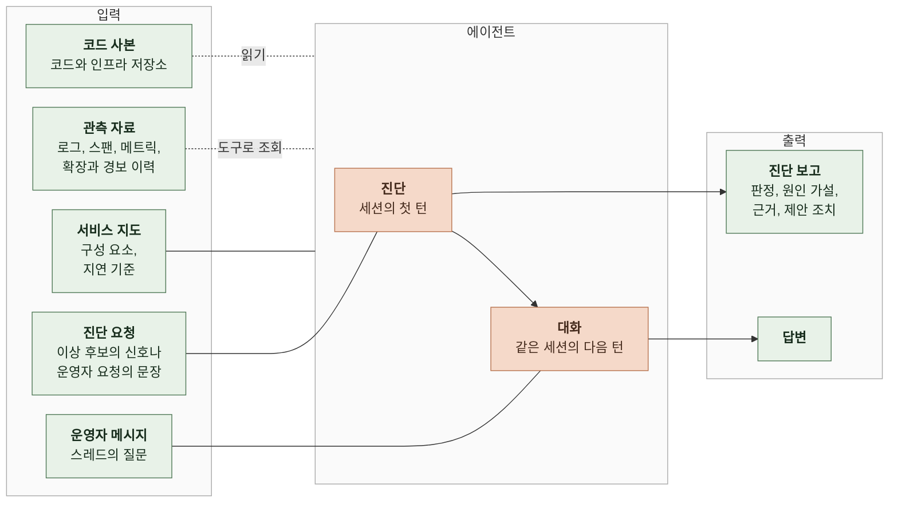

# 3. 태스크 정의

이 문서는 에이전트가 풀 문제와 진단과 대화의 입출력 의미를 정한다.

감시 규칙은 4-2 소프트웨어 설계에 있고 필드 이름과 형식은 5 계약에 있다. ([4-2-4 감시 규칙](4-2-DESIGN-SOFTWARE-ARCHITECTURE.md#4-2-4-감시-규칙), [5-5 이상 후보](5-CONTRACT.md#5-5-이상-후보), [5-6 운영자 요청](5-CONTRACT.md#5-6-운영자-요청), [5-7 진단 보고](5-CONTRACT.md#5-7-진단-보고), [5-9 슬랙 메시지](5-CONTRACT.md#5-9-슬랙-메시지))

 

### 3-1 전체 흐름

에이전트가 풀 문제는 둘이다. 진단 요청을 받은 구간이 장애인지 판정한다. 장애이면 원인이 있는 구성 요소와 그 메커니즘, 조치를 근거와 함께 보고한다. 보고 뒤에는 운영자의 질문에 답한다.

 

### 3-2 진단

**1. 입력**

| 항목 | 출처 | 필수 여부 | 비어 있을 때 |
|---|---|---|---|
| 진단 요청 | 이상 후보는 감시 코드, 운영자 요청은 슬랙 멘션 | 필수 | - |
| 서비스 지도 | 설정 파일 | 필수 | 에이전트가 시작하지 않음 |
| 관측 자료 | 조회 도구 | 필수 앱 메트릭만 선택 | Prometheus 주소가 없으면 앱 메트릭 없이 진단함   공식 MCP 연결에 실패하면 실행 실패 |
| 코드 사본 | 코드 저장소 | 필수 | 시작 때 받지 못하면 에이전트가 시작하지 않음   진단 전 갱신에 실패하면 마지막으로 받은 커밋으로 진단함 |

 

**2. 출력**

| 항목 | 의미 | 기대 결과 |
|---|---|---|
| 판정 | 장애, 장애 아님, 판단 불가 중 하나 | 진입 경로의 지연이나 실패율이 기준을 넘은 것이 자료로 확인되면 장애 |
| 영향 범위 | 지연이나 실패를 겪은 요청 경로와 그 정도 | 진입 스팬 이름과 p95나 실패율 수치가 있음 |
| 첫 이상 시각 | 사용자 요청이 처음 지연 기준을 넘거나 실패한 시각 분 단위 | 1분 단위 조회 결과에서 처음 기준을 넘은 시각과 같음 |
| 의심 구성 요소 | 원인일 가능성이 높은 순서로 1~3개 | 증상이 드러난 곳이 아니라 원인이 있는 구성 요소를 첫 번째로 둠 |
| 원인 가설 | 그 구성 요소가 왜 장애를 일으켰는지 | 증상이 아니라 메커니즘(상한, 정책, 쿼리)을 말함 |
| 근거 | 원인 가설을 뒷받침하는 관찰 목록 조회 근거: 조회 하나와 그 결과의 값 코드 근거: 코드 사본의 위치와 그 위치의 문장 | 조회 근거: 값이 그 조회 결과에 실제로 있음 코드 근거: 인용 문장이 그 줄 범위에 실제로 있음 |
| 제안 조치 | 즉시 조치와 근본 조치 | 원인 가설에 직접 대응함 첫 항목이 가장 먼저 할 일 |
| 배제한 원인 | 조회로 정상임을 확인해 원인에서 뺀 것 | 반증 단계의 관찰과 맞음 |
| 요약 칸 | 슬랙 메시지에 그대로 보이는 짧은 글 | 칸마다 짧은 명사구 |

판단 불가는 모델이 자료를 보고도 판정을 정하지 못한 결과다. 모델 호출 실패나 공식 MCP 연결 실패로 진단을 끝내지 못한 것은 실행 실패다.

 

**3. 사례**

| 상황 | 기대 결과 |
|---|---|
| 채팅 턴 p95가 기준을 넘음 큐 대기 p95가 1초를 넘음 백엔드 CPU가 36% 이하 | 판정: 장애 첫 번째 의심 구성 요소: 백엔드 채팅 턴 실행기 원인 가설: 동시 실행 수 부족 근거: 그 수를 정한 코드 위치 |
| 채팅 턴 p95가 기준을 넘음 AI 서버의 모델 호출 스팬이 시간 대부분을 차지함 큐 대기와 CPU에 여유가 있음 | 판정: 장애 첫 번째 의심 구성 요소: AI 서버 원인 가설: 외부 LLM 제공자의 응답 지연 배제한 원인: 큐 대기, CPU |
| 채팅 턴 p95가 기준을 넘음 AI 서버 CPU가 평균 65~74%, 최대 100% 확장 이력이 없음 | 판정: 장애 의심 구성 요소: 첫 번째 AI 서버, 두 번째 오토스케일링 근거: 확장 정책 위치 |
| 스토리 목록 p95가 기준을 넘음 DB CPU가 82~90% 스토리별 누적 턴 합산 쿼리의 합계 시간이 가장 김 | 판정: 장애 첫 번째 의심 구성 요소: DB 근거: 그 쿼리를 만드는 코드 위치 근본 조치: 쿼리 수정 방향 |
| 선택지 p95가 기준을 넘음 서버 CPU는 첫 3분만 100% 시간 대부분이 AI 서버 스팬에서 걸림 | 판정: 장애 첫 번째 의심 구성 요소: AI 서버 서버를 첫 번째로 두지 않음 |
| 부하로 CPU가 66%까지 오름 모든 요청 경로가 지연 기준 안 | 판정: 장애 아님 |
| 큐 대기 신호로 이상 후보가 열림 채팅 턴 p95는 지연 기준 안 | 판정: 장애 아님 근거: 진입 스팬 p95와 지연 기준의 비교 |
| 채팅 턴 1분 p95가 1분 동안만 기준을 넘음 나머지는 기준 안 | 판정: 장애 아님 근거: 기준을 넘은 시각과 값 |
| 운영자가 "방금 채팅 응답이 느렸는데 봐 줘"라고 멘션함 | 요청 시각 전후의 채팅 턴 진입 스팬부터 조회해 판정한 보고를 그 메시지의 스레드에 올림 |
| 신호가 난 뒤 관측 자료 수집이 끊겨 조회 결과가 비어 있음 | 판정: 판단 불가 |

 

### 3-3 대화

**1. 입력**

| 항목 | 출처 | 필수 여부 | 비어 있을 때 |
|---|---|---|---|
| 운영자 메시지 | 슬랙 스레드 | 필수 | - |
| 세션 맥락   진단 턴의 조회와 보고, 앞선 대화 턴 | 세션 | 필수 | 세션 파일을 읽지 못하면 답변 없이 실행 실패로 세션을 끝냄 |
| 관측 자료와 코드 사본 | 진단과 같음 보고 제출 도구만 쓸 수 없음 | 필수 | 진단과 같음 |

 

**2. 출력**

| 항목 | 설명 |
|---|---|
| 답변 | 세션 맥락의 조회 결과와 보고를 근거로 한 글   새로 확인할 것은 조회 도구와 코드 사본으로 확인함   조치 지시에는 바꾸지 않고 바꿀 위치와 방법을 적음 |

 

**3. 사례**

| 운영자 메시지 | 기대 결과 |
|---|---|
| "자세히 알려 줘" | 보고의 영향, 원인 가설, 근거 전체와 검증 결과, 조치 전체를 풀어 쓴 답변 |
| "왜 오토스케일링을 두 번째로 봤어?" | 진단 턴의 확장 이력 조회와 확장 정책을 근거로 답변 |
| "지금은 회복됐어?" | 진입 스팬 지연을 새로 조회해 현재 p95와 지연 기준을 비교한 답변 |
| "실행기 동시 실행 수를 8로 올려 줘" | 바꾸지 않음 어떤 저장소의 어떤 파일에서 어떤 값을 바꾸면 되는지와 예상 효과를 적은 답변 |
| 세션이 끝난 뒤의 메시지 | 세션이 끝났다고 한 번 알림 |
