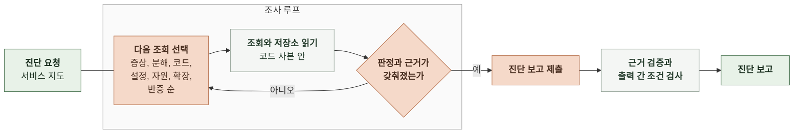

# 4-1 인지 구조 설계

이 문서는 에이전트 루프, 진단에서 자료를 골라 판단하고 끝내는 방식, 모델과 코드의 책임을 정한다.

입력과 출력의 의미는 3 태스크 정의에 있고 감시 규칙과 구성 요소 사이의 호출은 4-2 소프트웨어 설계에 있다. ([3-2 진단](3-TASK-DEFINITION.md#3-2-진단), [4-2-4 감시 규칙](4-2-DESIGN-SOFTWARE-ARCHITECTURE.md#4-2-4-감시-규칙))

 

### 4-1-1 접근과 근거

| 방식 | 판단 | 이유 |
|---|---|---|
| 규칙만으로 탐지와 진단 | 탐지에만 사용 | 이상 여부는 기준값으로 가를 수 있음 원인은 장애마다 필요한 조회가 달라 규칙이 계속 늘어남 |
| 코드가 자료를 모아 한 번 호출 | 사용 안 함 | 어떤 하위 스팬이나 쿼리를 볼지 미리 알 수 없어 모든 자료를 넣어야 함 |
| 에이전트 루프로 진단 | 사용 | 신호나 운영자의 말에서 출발해 필요한 조회만 골라 가설을 세우고 반증함 |
| 모델이 감시부터 진단까지 | 사용 안 함 | 1분마다 모델을 호출하면 하루 1,440회 |

 

### 4-1-2 진단 전략

 

**1. 에이전트 루프**

| 루프의 단계 | 내용 |
|---|---|
| 입력 | 시스템 프롬프트, 도구 정의, 절차 목록, 진단 요청, 지금까지의 도구 호출과 결과 |
| 출력 | 도구 호출이나 진단 보고 제출 |
| 도구 실행 | Agent SDK가 실행하고 결과를 대화에 더해 모델을 다시 호출함 코드가 조회 결과에 번호를 붙임 |
| 대화 턴 | 같은 대화에 운영자 메시지를 더해 같은 루프로 처리함 보고 제출 대신 글로 답함 |

시스템 프롬프트에는 역할, 서비스 지도, 지연 기준, 자료 위치, 판정 규칙, 조사 순서 중 증상과 분해와 반증, 조회 규칙만 둔다. 보고 칸을 채우는 규칙은 보고 제출 도구의 입력 설명에 둔다.

 

**2. 조사 순서**

순서는 지침이다. 앞 단계에서 원인이 분명하면 다음 단계를 줄인다. 운영자 요청은 요청 문장과 요청 시각으로 증상 단계의 조회 구간과 요청 경로를 정한다.

| 순서 | 단계 | 조회 대상 | 확인 내용 |
|---|---|---|---|
| 1 | 증상 | 진입 스팬 이름별 지연과 실패율 하위 스팬을 섞어 집계하지 않음 | 영향 범위와 첫 이상 시각 |
| 2 | 분해 | 영향받은 진입 경로의 서비스와 스팬 이름별 합계 시간, 쿼리 모양별 합계 시간 | 시간이 걸린 곳(대기, 외부 호출, DB) |
| 3 | 코드 | 시간이 걸린 스팬 이름과 SQL로 코드 사본을 검색한 결과 | 원인 코드 위치 |
| 4 | 설정 | 서비스 지도에 적힌 application 설정과 인프라 정의 | 동시성 상한, 큐 크기, 태스크 크기, 확장 정책 |
| 5 | 자원 | 해당 구성 요소의 CPU 평균과 최대, 메모리, 연결 수 | 자원 포화 여부 |
| 6 | 확장 | 확장 이력과 경보 이력 | 확장 여부와 확장이 일어나지 않은 이유 확장 정책이 있는 구성 요소만 봄 |
| 7 | 반증 | 다른 구성 요소의 지연과 자원 | 다른 구성 요소가 정상이라는 관찰 |
| 8 | 설계 의도 | 원인 구성 요소의 스펙과 설계 문서 | 조치가 설계 의도와 맞는지 |

 

**3. 원인 영역별 절차**

3~6단계는 시간이 걸린 곳에 따라 볼 것이 달라 원인 영역별 절차로 나눠 에이전트 스킬로 둔다. 모델은 분해 결과로 영역을 정한 뒤 그 영역의 절차를 읽고 따른다. 어느 영역에도 맞지 않으면 시간이 걸린 스팬 이름과 SQL로 코드 사본을 검색해 원인 코드 위치를 찾는다.

| 원인 영역 | 선택 조건 | 절차 내용 |
|---|---|---|
| DB와 공유 자원 | DB나 캐시 스팬에서 시간이 걸림 | 경로를 좁히지 않은 쿼리 묶음 합계 시간 1위 쿼리를 만드는 코드 위치와 쿼리 모양 대조 자원과 연결 상한 완화와 구조 해결의 구분 |
| 대기와 상한 | 대기 스팬에서 시간이 걸리고 자원에 여유가 있음 | 동시성 상한과 큐 크기를 정한 설정과 코드 대기 구간의 부하를 그 상한과 대조 |
| 자원 포화와 확장 | 시간이 걸린 구성 요소의 CPU나 메모리가 참 | CPU와 메모리 해석 확장 정책이 있으면 확장 정책과 확장 이력을, 없으면 설정에서 읽은 자원 크기를 대조 |

 

**4. 판단 규칙**

| 판단 | 규칙 |
|---|---|
| 장애 판정 | 진입 스팬의 1분 지연과 실패율이 연속 5분 중 3분 이상 조건을 넘은 경로가 있으면 장애 그보다 짧게 넘었으면 장애 아님으로 하고 넘은 시각과 값을 근거에 적음 대기 지연이나 자원 신호로 열린 후보도 진입 스팬을 조회한 뒤 판정함 |
| 분해 우선 | 시간이 어디서 걸렸는지 확인하기 전에 자원 메트릭으로 원인을 정하지 않음 시간이 가장 많이 걸린 곳을 첫 번째 의심 구성 요소로 둠 다른 곳을 첫 번째로 두면 그 이유를 원인 가설에 적음 |
| CPU 해석 | 최대 90% 이상이고 평균이 확장 목표 아래이며 확장 이력이 없으면 확장 조건을 채우지 못한 포화로 봄 시간이 걸린 구성 요소 중 확장 정책이 있는 것에만 적용함 |
| 근거 | 원인이 된 코드나 설정의 위치는 코드 근거로 남김 반증 단계에서 정상임을 확인한 것은 배제한 원인으로 남김 |
| 문서와 코드 | 원인 판단은 관측 자료와 코드로 함 스펙과 설계 문서는 의도이므로 코드와 다르면 코드를 현재 동작으로 보고 차이를 근거에 남김 |
| 조치 | 즉시 조치는 운영자가 바로 할 수 있는 임시 완화 근본 조치는 원인 코드나 설정을 고치는 것으로 그 위치와 수정 방향을 적음 근본 조치를 쓰기 전에 원인 코드를 다시 읽어 지금 코드의 조건과 맞는지 확인함 스펙이나 설계 문서의 의도와 어긋나면 그 사실과 문서 위치를 함께 적음 자료가 늘수록 나빠지는 원인이면 인덱스 같은 완화와 구조를 바꾸는 해결을 구분함 |

 

**5. 조회 도구**

| 도구 | 결과 | 출처 | 자체 도구를 둔 이유 |
|---|---|---|---|
| 로그와 스팬 검색 | 매핑, 집계 질의 결과, 건수 | OpenSearch 공식 MCP | |
| 인프라 메트릭과 경보 | 구성 요소 메트릭의 시계열, 경보 상태, 경보 이력 | CloudWatch 공식 MCP 지표 차원을 설정한 구성 요소가 있을 때만 | |
| 앱 메트릭 | 서비스가 내보낸 메트릭의 PromQL 결과 | 자체 도구 AMP를 쓰면 Prometheus 공식 MCP | 관측 서버 Prometheus는 AMP용 공식 MCP로 읽을 수 없음 |
| 확장 이력 | 태스크 수 변경 시각과 이유 | 자체 도구 CloudWatch와 같은 조건 | 확장 활동 기록을 부를 공식 MCP 도구가 없음 |
| 시간 분해 | 진입 경로 하나의 스팬을 서비스와 스팬 이름별로 묶은 건수, 합계 시간, p95, 진입 스팬 합계 대비 비율 합계 시간 순 | 자체 도구 | 검색으로도 되지만 모델이 이 단계를 건너뛰거나 진입 스팬 조건을 틀림 |
| 쿼리 묶음 | DB 쿼리문을 모양별로 묶은 건수, 합계 시간, p95. 합계 시간 순 모양은 `IN` 목록과 문자열, 숫자 값을 지운 쿼리문 | 자체 도구 | 검색은 값만 다른 같은 쿼리를 합치지 못해 순위가 틀어지고 모델도 합치라는 지시를 따르지 않음 |
| 저장소 읽기 | 파일 내용, 파일 이름 검색, 문장 검색 | 코드 사본 | |
| 절차 읽기 | 원인 영역별 절차의 본문 | 에이전트 스킬 | |
| 진단 보고 제출 | 없음 진단을 끝냄 | 자체 도구 | 보고를 정해진 칸으로 받아야 코드가 판정 조건을 검사하고 근거를 대조함 |

시간 분해와 쿼리 묶음은 구간을 스팬이 끝난 시각으로 정한다. 저장소 읽기와 절차 읽기는 조회 횟수에 세지 않는다.

| 구분 | 도구 | 스킬 |
|---|---|---|
| 정체 | 코드가 실행하는 함수 | 모델이 읽는 절차 글 |
| 돌려주는 것 | 조회 결과 같은 자료 | 일하는 순서와 판단 기준 |
| 결과 | 같은 입력이면 늘 같은 계산 | 따를지는 모델에 달림 |
| 매 요청에 붙는 것 | 정의 전체 | 이름과 한 줄 설명만 본문은 읽을 때만 |

 

### 4-1-3 모델과 코드의 책임

| 담당 | 책임 |
|---|---|
| 모델 | 조회 선택, 판정, 원인 추론, 조치 제안, 대화 턴의 답변   구성 요소는 서비스 지도의 이름으로만 지목함 |
| 코드 | 신호 판정, 이상 후보 열기와 닫기 모델을 호출하지 않음   조회 결과마다 번호를 붙여 모델에 돌려주고 기록함   근거 검증 근거의 값이 그 번호의 조회 기록에 있는지와 인용 문장이 코드 사본의 해당 줄 범위에 있는지 확인함 통과하지 못한 근거는 지우지 않고 검증 실패로 표시함   출력 간 조건 검사 어기면 위반 내용을 모델에 한 번 돌려보내고 다시 어기면 실행 실패   저장소 읽기를 코드 사본 안 경로로 제한함   모델이 제출하지 않은 판정을 채우지 않고 실행 실패로 남김 |
| OpenSearch 역할 | 읽기 사용자의 역할이 운영 로그의 메시지 원문과 식별자 필드를 뺌 코드는 시작 때 그 필드가 조회 결과에 보이지 않는지 확인함 |

 

### 4-1-4 상태와 종료

세션 사이에는 상태를 두지 않는다. 앞선 세션의 보고는 다음 진단의 입력에 넣지 않는다.

| 조건 | 처리 |
|---|---|
| 모델이 진단 보고를 제출함 | 근거 검증과 출력 간 조건 검사 후 진단 턴 종료 세션은 열어 둠 |
| 조회 25회를 씀 | 도구 없이 진단 보고를 제출하라고 한 번 요청함 그래도 제출하지 않으면 실행 실패 |
| 시작 후 5분이 지나거나 진단 턴 비용이 $0.50에 이름 | 진행 중인 호출을 끊고 실행 실패 |
| 운영자가 스레드에 메시지를 씀 | 같은 세션을 이어 대화 턴을 실행함 |
| 턴이 끝났을 때 세션 비용이 $2.00을 넘음 | 스레드에 알린 뒤 세션 종료 진단 턴에서 넘으면 보고를 올린 뒤 알림 |
| 이상 후보를 닫거나 운영자 요청의 보고를 올린 뒤 24시간이 지남 | 그 세션 종료 이후 메시지에는 종료됐다고 한 번 알림 |
