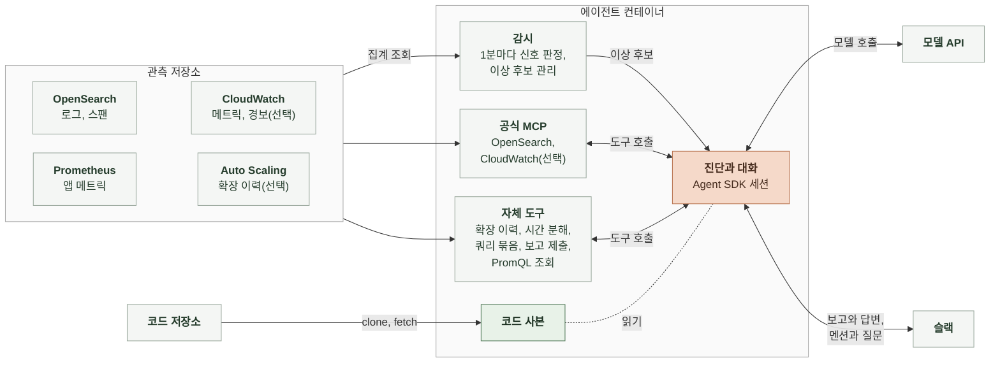
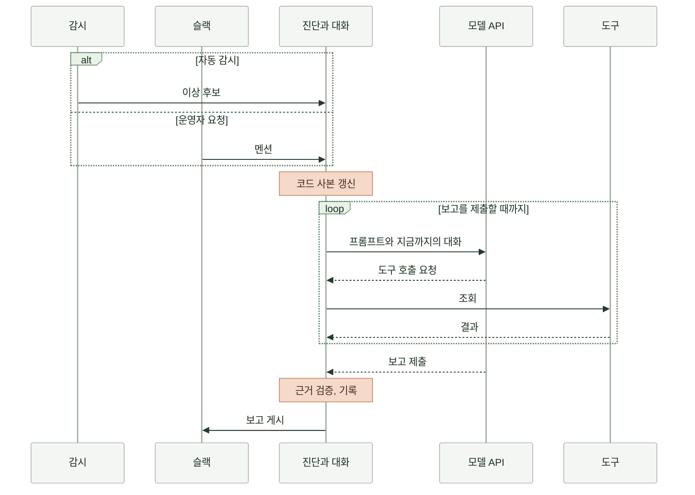
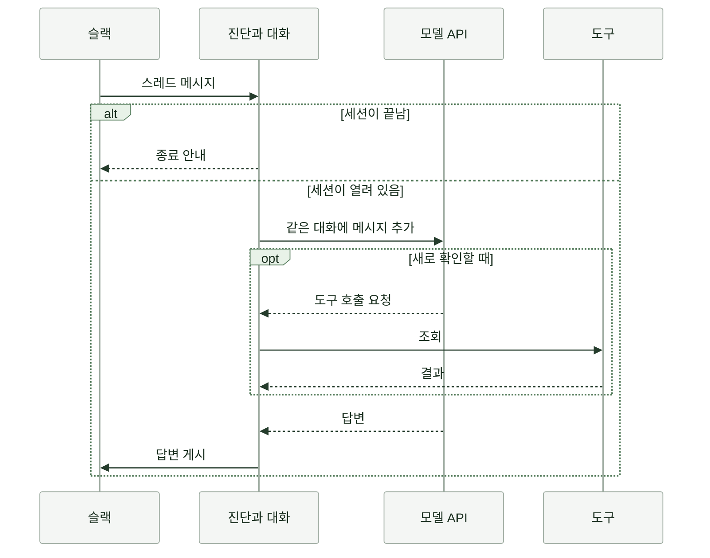

# 4-2 소프트웨어 설계

이 문서는 에이전트의 시스템 경계, 실행 환경, 요청 처리 흐름, 감시 규칙, 상태, 평가 방식을 정한다.

진단 전략은 4-1 인지 구조에 있고 설정, 자료 원천, 결과 파일의 형식은 5 계약에 있다. ([4-1-2 진단 전략](4-1-DESIGN-COGNITIVE-ARCHITECTURE.md#4-1-2-진단-전략), [5-2 설정 파일](5-CONTRACT.md#5-2-설정-파일), [5-8 실행 폴더](5-CONTRACT.md#5-8-실행-폴더))

 

### 4-2-1 시스템 경계

 

### 4-2-2 실행 환경

| 항목 | 운영 | 로컬 실행 |
|---|---|---|
| 실행 위치 | 관측 서버의 컨테이너 | 운영자 PC |
| 설정 파일 | 관측 서버의 파일 | PC의 파일 |
| 비밀값 | 관측 서버의 비밀 파일 | PC의 비밀 파일 |
| AWS 자격 증명 | 쓰지 않음 | CloudWatch를 쓸 때 AWS 프로필 |
| 실행 폴더와 세션 파일 | 관측 서버의 볼륨 | PC의 폴더 |

두 환경은 같은 코드와 프롬프트를 쓴다. 로컬 실행은 개발과 평가에 쓴다.

 

### 4-2-3 요청 처리 흐름

**1. 진단**

 

**2. 대화 턴**

 

### 4-2-4 감시 규칙

| 규칙 | 내용 |
|---|---|
| 판정 | 1분마다 최근 5분을 다시 조회해 1분 단위로 아래 신호를 판정함 이미 판정한 구간도 새로 읽은 값으로 다시 판정함 CloudWatch 지표는 설정한 주기마다 묶어 읽고 1분 단위로 판정함 자료가 있는 대상은 모두 판정하고 대상 수에 상한을 두지 않음 |
| 판정 기준 시각 | 진입 지연, 대기 지연, 실패율은 그 1분 안에 끝난 스팬으로 판정함 |

```mermaid
gantt
    dateFormat HH:mm
    axisFormat %H:%M
    tickInterval 1minute
    section 17:00 판정
    최근 5분 :a1, 16:55, 5m
    section 17:01 판정
    최근 5분 :a2, 16:56, 5m
    section 17:02 판정
    최근 5분 :a3, 16:57, 5m
```

| 확정 | 종류와 대상이 같은 신호가 최근 5분 가운데 3분 이상 조건을 넘으면 확정함 신호의 첫 시각은 그 5분 안에서 조건을 처음 넘은 시각 |
| 건너뛴 구간 | 조회 실패나 중단으로 건너뛴 구간은 다음 조회의 최근 5분에 들면 그때 판정함 5분이 지나도록 판정하지 못한 구간은 조건을 넘었는지 알 수 없으므로 넘은 것으로도 넘지 않은 것으로도 세지 않음 |
| 지연 기준 | 서비스 지도의 요청 경로별 기준만 씀 과거 값으로 기준선을 만들지 않음 |
| 운영자 요청 | 신호 규칙과 대기 시간을 거치지 않고 바로 진단을 요청함 하루 비용 상한만 같이 적용함 |

| 신호 | 측정값 | 조건 |
|---|---|---|
| 진입 지연 | 진입 스팬 이름별 1분 p95 | 서비스 지도의 해당 요청 경로 지연 기준 초과 진입 스팬이 분당 20건 이상 |
| 대기 지연 | 대기 스팬 1분 p95. 대기 스팬은 설정에 이름을 적은 스팬 | 1초 이상 대기 스팬이 분당 20건 이상 |
| 실패율 | 진입 스팬 중 오류 상태 비율 로드밸런서 응답 중 5xx 비율 | 1% 이상 요청이 분당 20건 이상 |
| 오류 로그 | 서비스별 오류 수준 로그 수 | 분당 10건 이상 |
| 자원 포화 | 지표 차원을 설정한 구성 요소의 CPU와 메모리 평균, DB CPU, 캐시 엔진 CPU | 70% 이상 |

| 상황 | 처리 |
|---|---|
| 신호가 확정됐고 열린 이상 후보가 없음 | 이상 후보를 열고 3분 뒤 진단을 요청함 기다리는 3분 동안 확정된 다른 신호도 같은 후보에 넣어 진단 요청에 함께 보냄 3분 안에 후보가 닫히면 진단을 요청하지 않음 |
| 진단을 요청할 때 그날 비용이 하루 상한을 넘음 | 진단은 요청하지 않음 진단 생략 사유를 남김 |
| 신호가 확정됐고 열린 이상 후보가 있음 | 열린 이상 후보의 신호 목록에 더함 진단을 다시 요청하지 않음 |
| 열린 이상 후보의 첫 보고가 장애 아님이나 판단 불가였고 그 뒤 진입 지연이나 실패율 신호가 그 후보에 새로 더해짐 | 같은 후보로 후속 진단을 한 번 요청함 후보마다 한 번만 함 |
| 열린 이상 후보의 모든 신호가 10분 동안 조건을 넘지 않음 | 이상 후보를 닫음 넘지 않은 것으로 봤던 구간이 다시 조회에서 넘은 것으로 바뀌면 그 뒤부터 10분을 다시 셈 판정하지 못한 구간이 중간에 끼면 10분을 처음부터 다시 셈 |

 

### 4-2-5 상태와 자원

| 상태 | 위치 | 수명 |
|---|---|---|
| 열린 이상 후보와 진단 대기열 | 메모리 | 프로세스 다시 시작하면 비어 있음 진행 중이던 진단은 버려짐 |
| 하루 비용 누적 | 메모리와 실행 상위 경로의 비용 장부 | UTC 하루 같은 상위 경로로 다시 시작하면 장부에서 이어 셈 |
| 세션의 대화 | 세션 저장 경로의 파일 | 세션과 같음 다시 시작한 프로세스는 이전 실행의 세션을 이어 받지 않아 그 스레드의 질문에 답하지 못함 |
| 코드 사본 | 작업 폴더 | 프로세스 진단 세션을 열기 전에 설정의 브랜치 최신 커밋으로 맞춤 |
| 진단 요청, 진단 보고, 조회 기록, 세션 | 실행 폴더 | 실행마다 새 폴더 사건이 끝날 때마다 기록함 운영은 볼륨에 남음 |

| 자원 | 규칙 |
|---|---|
| 진단 턴 | 한 번에 하나 진단 중 들어온 요청은 대기열에서 기다림 |
| 대화 턴 | 세션마다 차례로 다른 세션의 대화 턴이나 진단 턴과는 동시에 실행함 |
| 공식 MCP의 프로세스 | SDK 세션을 열 때 시작하고 닫을 때 종료함 |

 

### 4-2-6 재현 평가와 재생 모드

두 방식 모두 보관한 부하 테스트 자료를 사용하며 평가 사례 파일의 기대값으로 채점한다.

| 방식 | 실행 |
|---|---|
| 재현 평가 | 사례마다 요청 문장으로 진단 턴만 실행함 감시와 슬랙 없음 |
| 재생 모드 | 가상 시계로 보관 자료를 1분 단위로 재생하고 실시간과 같은 감시, 탐지, 진단 코드를 실행함 |

| 사례 | 1-2의 병목 | 정답 판정 |
|---|---|---|
| 1 | 채팅 턴 큐 대기 | 장애 |
| 2 | 동시 턴 상한 재도달 | 장애 아님 큐 대기는 있지만 응답 지연이 기준 밑 |
| 3 | AI 서버 CPU 포화 | 장애 |
| 4 | DB CPU 포화 | 장애 |
| h1 | AI 서버 CPU 포화(3과 다른 시간대) | 장애 |
| n1 | 없음(정상 구간) | 장애 아님 |

사례는 2026-10-08~10 부하 테스트에서 실제로 난 장애 구간이다.

| 재생 규칙 | 내용 |
|---|---|
| 가상 시계 | 감시, 후보 관리, 진단 요청 시각, 프롬프트의 현재 시각이 가상 시각을 따름 진단 턴과 대화 턴이 도는 동안 가상 시계를 멈춤 가상 시계 시작 전의 구간은 판정하지 않음 |
| 미래 자료 차단 | 로그와 스팬은 가상 시각까지만 재생 인덱스로 복사하고 감시와 모델은 재생 인덱스만 읽음 인프라 메트릭, 확장 이력, 경보 이력은 보관 파일을 읽는 재생 도구가 가상 시각까지만 돌려줌 |
| 코드 사본 | 장애 당시 커밋으로 고정함 |
| 슬랙 | 기본으로 게시하지 않고 실행 폴더에만 기록함 |

| 채점 규칙 | 내용 |
|---|---|
| 채점 주체 | 판정, 구성 요소, 코드 근거 경로는 기대값과 대조함 원인과 조치는 보고를 낸 구성을 가린 채 LLM이 정답과 비교해 판정함 핵심어 일치는 보조로 함께 냄 |
| 확인용 사례 | 진단 규칙을 고칠 때 보는 사례와 분리해 고친 뒤 마지막에만 잼 확인용 사례에서 드러난 약점을 고치면 그 사례는 확인용에서 뺌 |
| 사례의 답 | 프롬프트와 절차에 사례의 답(테이블, 파일, 수치, 조치)을 넣지 않음 |
| 사례 추가 | 운영에서 놓쳤거나 틀린 진단과 운영자가 잡혀야 한다고 본 상황을 사례로 더함 보관 기간이 끝나기 전에 그 구간의 자료를 보관함 겪지 않은 장애를 상상해 만든 사례는 넣지 않음 |
