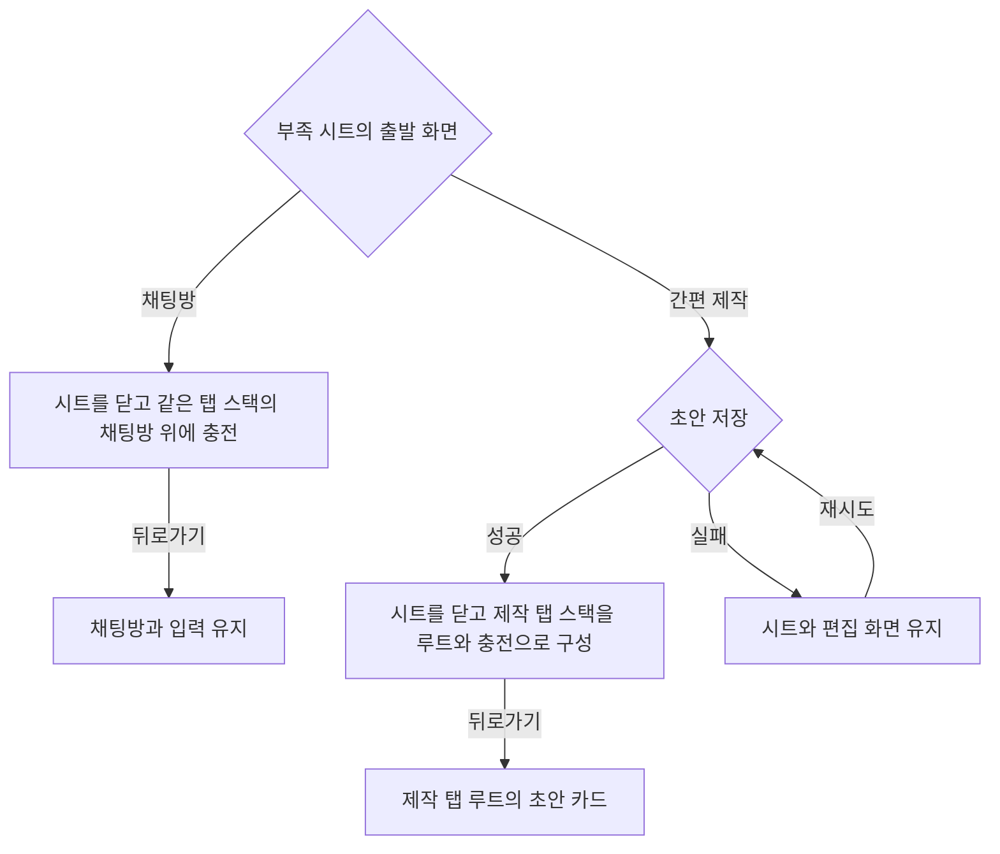

# 3-2 화면 흐름: iOS

 

### 3-2-1 탭과 부족 시트

| 시작 | 조작 | 결과 |
|---|---|---|
| 충전 화면 | 탭 선택 | 화면 안 내용만 변경, 스택에 화면 추가 없음 |
| 무료 충전 | 아래로 당기기 | 잔액과 출석 여부 갱신 |
| 내역 | 아래로 당기기 | 잔액과 첫 페이지 갱신, 실패하면 기존 목록 유지 |
| 충전 화면 | 가장자리 밀기 또는 뒤로 버튼 | 진입 전 화면. 푸시로 열었으면 마이 탭 루트 |
| 부족 시트 | 끌어내리기, 바깥 탭 또는 닫기 | 처리 중이 아니면 시트 닫기, 입력 유지 |
| 출석 또는 충전 이동 처리 중 | 끌어내리기 또는 바깥 탭 | 시트 유지 |
| 저장 실패 | 재시도 또는 닫기 | 시트와 편집 화면 유지 |

출석 성공과 중복 지급, 오류는 공통 흐름으로 표시한다. ([공통 3-2-1](../3-2-INTERACTION-FLOWS.md#3-2-1-출석과-내역), [2-2-2](2-2-REQUIREMENTS.md#2-2-2-부족-안내와-수명))
