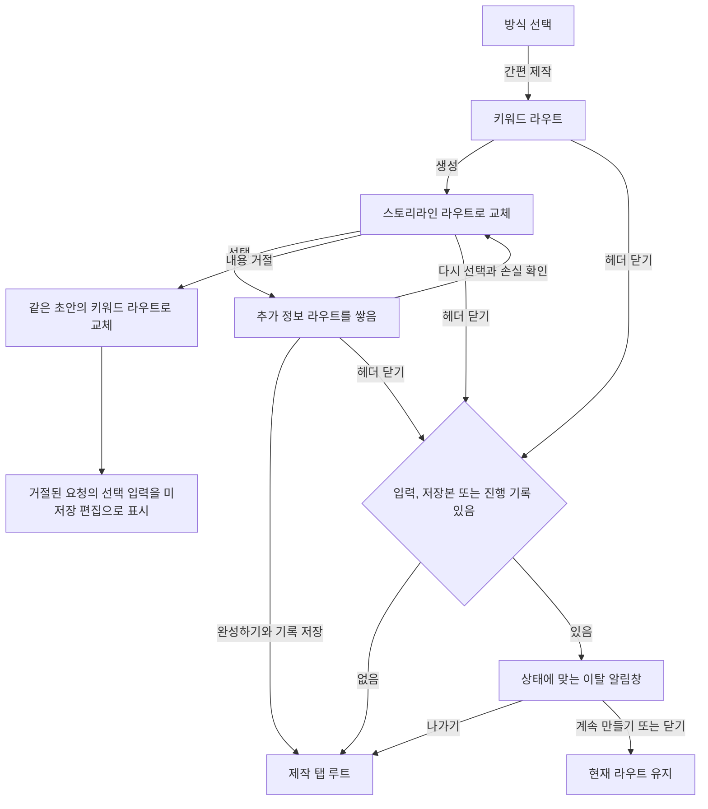
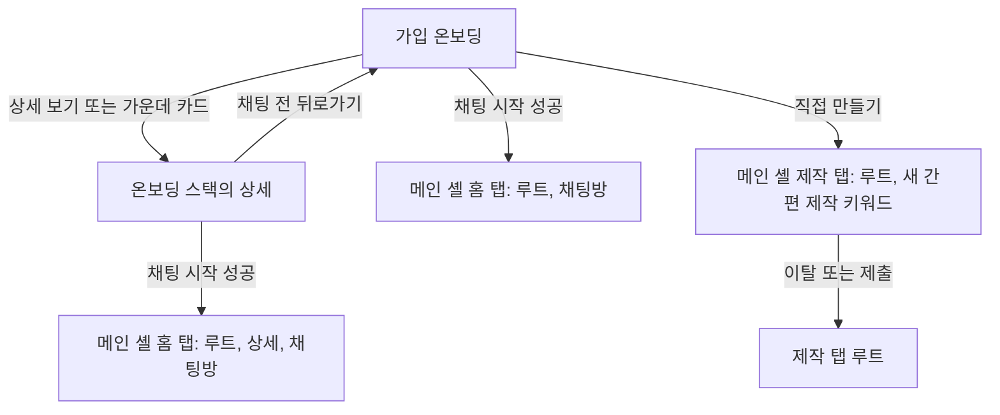

# 3-2 화면 흐름: iOS

기준: [공통 흐름](../3-2-INTERACTION-FLOWS.md), [iOS 화면](3-1-INFORMATION-ARCHITECTURE.md).

 

### 3-2-1 제작과 상세

| 조작 | 결과 |
|---|---|
| 키워드에서 생성 | 키워드 라우트를 스토리라인 라우트로 교체 |
| 추가 정보의 다시 선택하기 | 손실 확인 후 추가 정보 라우트를 걷고 스토리라인으로 복귀 |
| 헤더 닫기 | 공통 저장과 이탈 확인을 거친다. 나가면 방식 선택을 포함한 제작 흐름의 라우트를 모두 걷고 제작 탭 루트로 돌아감 |
| 가장자리 밀기와 뒤로 버튼 | 간편 제작, 일반 제작, 재제출과 수정 화면에는 뒤로 버튼 없음. 가장자리 밀기는 헤더 닫기가 확인을 띄우는 동안 동작하지 않고, 확인 없이 바로 나가는 조건에서는 한 화면 복귀. 방식 선택은 시스템 뒤로 복귀 ([공통 UI iOS 이탈 확인](../../../../ui/IOS/2-2-REQUIREMENTS.md#2-2-1-화면과-기기), [I-116](DECISIONS.md#i-116)) |
| 카드로 연 추가 정보 초안 | 스토리라인 라우트 위에 추가 정보 라우트를 쌓아 엶 |
| 스토리라인 내용 거절 | 같은 초안의 키워드 라우트로 교체. 거절된 요청의 선택 입력을 미저장 편집으로 채움 |
| 이프 부족 시트의 충전 이동 | 초안 저장 성공 뒤 제작 흐름의 라우트를 걷고 제작 탭 루트 위에 이프 충전. 돌아오면 초안 카드가 있는 제작 탭 루트 ([PAYMENT iOS 탭과 부족 시트](../../../PAYMENT/CLIENT/IOS/3-2-INTERACTION-FLOWS.md#3-2-1-탭과-부족-시트)) |
| 추가 정보 조작 | 추가와 삭제, 추천 토글 및 스토리라인 접기는 키보드 유지. 입력 삭제는 다음 칸, 없으면 이전 칸으로 초점 이동. 마지막 삭제와 본문 빈 곳 탭은 키보드 닫기 |
| 일반 제작 승인 | 폼 라우트를 상세로 바꾸고 그 위에 채팅방. 채팅 생성 실패는 상세 |
| 수정 완료 | 수정 라우트를 걷고 진입했던 상세 또는 제작 탭 루트에서 갱신 |
| 카드 더보기와 길게 누르기 | 같은 옵션 시트. 옵션을 닫은 뒤 삭제 확인 알림창 또는 신고 시트 |
| 상세 삭제 | 현재 탭 스택에서 상세와 그 위 화면을 걷고 제작 탭 루트를 선택해 목록 갱신 |
| 채팅 시작 시트의 페르소나 생성 | 시트를 닫고 같은 스택에 페르소나 생성. 상세로 돌아오면 시트를 다시 열고 생성했으면 새 페르소나 선택 |
| 저장 충돌 | 일반 제작 보조는 남겨두기, 간편 제작 보조는 닫기. 저장하기는 파괴 역할이며 성공 토스트 표시 |

 

### 3-2-2 가입 온보딩

1. 좌우로 넘기거나 옆 카드를 눌러 가운데 스토리를 바꾼다. 마지막 다음에 첫 스토리로 이어지며 한 편이면 넘기지 않는다.
2. 가운데 카드나 상세 보기는 온보딩 스택에 상세를 연다. 상세의 뒤로가기는 온보딩이다.
3. 채팅 시작하기는 가운데 스토리의 기본 시작 설정과 기본 주인공으로 하나의 채팅을 만든다. 실패하면 토스트와 함께 온보딩을 유지한다.
4. 채팅 생성이나 직접 만들기로 온보딩을 마치면 온보딩 화면과 스택을 버리고 위 그림의 탭과 스택으로 메인 셸을 처음 그린다. 세션 루트 교체가 아니므로 시작 화면을 거치지 않으며 이 실행에서 복원 탭을 적용하지 않는다. 채팅방의 뒤로가기는 바로 시작했으면 홈, 상세에서 시작했으면 상세와 홈 순서다.
5. 보류한 외부 진입이 있으면 위 그림의 탭과 스택을 구성한 뒤 소비하며 선택 탭과 스택은 [공통 UI iOS 외부 진입](../../../../ui/IOS/3-2-INTERACTION-FLOWS.md#3-2-3-외부-진입)을 따른다.

 

### 3-2-3 제작 안내

| 조작 | 결과 |
|---|---|
| 버튼 | 공통 단계별 동작. 버튼으로 닫을 때만 완료 기록 |
| VoiceOver 닫기 동작 | 공통 흐름의 뒤로가기와 같다. 화면을 떠나지 않고 대화창만 닫으며 인사는 건너뛰기, 완성 중은 닫기, 나머지는 확인으로 기록 ([I-120](DECISIONS.md#i-120)) |
| 대화창 바깥과 탭 바 탭 | 반응 없음 |
| 오리지널 스토리 보기 | 안내를 마친 뒤 탭 바에서 홈을 고른 것과 같이 홈 탭으로 바꾼다. 제작 탭 스택은 유지한다 |
| 추가 정보 초안을 이어서 만들기 | 스토리라인 라우트를 거쳐 추가 정보를 쌓으므로 거쳐 간 스토리라인 화면에서는 안내를 열지 않는다 |
