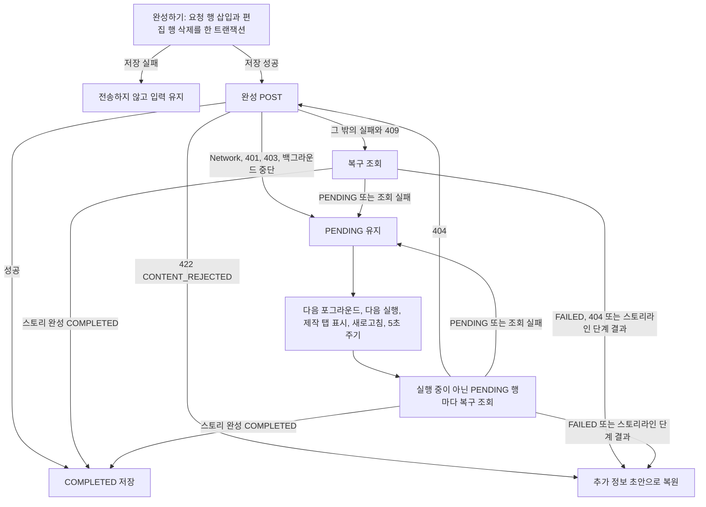

# 4-4 실행: iOS

기준: [공통 실행](../4-4-EXECUTION.md), [iOS 상태](4-3-STATE-MANAGEMENT.md).

 

### 4-4-1 목록과 상세

| 작업 | 실행 |
|---|---|
| 홈 섹션 | access 토큰을 싣지 않는 요청으로 한 번에 읽고 카드가 없는 섹션은 상태에서 거른다. 같은 스토리가 여러 섹션에 있으면 노출은 섹션마다 센다 |
| 탐색 목록 | 회원 본인 스토리를 서버가 빼도록 토큰을 싣는다. 첫 페이지와 다음 페이지를 한 작업으로 직렬화하고 새 순서를 받으면 다음 페이지를 취소한다. 끝 두 줄 앞에서 다음 페이지, 실패 뒤에는 자동 재요청을 멈추고 목록 끝 재시도. 중복 ID는 먼저 받은 값 유지 |
| 탐색 칸 전환 | 칸 안에서 다 나타난 표지와 들어오는 표지를 스토리 ID 키로 겹쳐 그린다. 들어오는 표지가 다 나타나면 그 표지가 바닥이 되고 이전 표지는 사라지며 그림을 다시 받지 않는다 |
| 좋아요 | 상세 재조회 취소 후 낙관 반영. 요청 중 화면 복귀는 새 조회를 시작하지 않음. 실패는 이전 값 복원, 홈으로 수 변화 전달 안 함 |
| 상세 복귀 | 숨김에서 보임으로 바뀌면 상세를 조용히 다시 읽고 골격으로 돌아가지 않음 |
| 이미지 | 원격 이미지는 `ManyakDesignSystem`의 이미지 요소로 불러온다. 표지는 주소 검사 없이 요청한다. 인물 썸네일, 인물 카드와 뷰어 URL은 [플랫폼 이미지 주소 조건](../../../../platform/CLIENT/IOS/3-EXECUTION.md#3-4-이미지)을 통과할 때만 요청하고 통과하지 못하면 이미지 없음으로 그린다 |
| 뷰어 | Store가 URL을 가지고 재조회에서 대상이 없어지면 닫는다. 배경과 그림의 탭 판정은 플랫폼 이미지 뷰어 규칙 |
| 푸터 배경 | 메타 위치로 진행률 계산, 200ms로 따라가며 surface와 backgroundNeutral 보간 |
| 온보딩 | `PopularOriginalStories`로 오리지널 채팅순 첫 페이지, single-flight 채팅 시작, 1초 머문 카드 노출 기록. 절반을 넘게 보인 카드를 가운데 선택으로 사용. 이벤트는 [분석 기준](../../../../reference/ANALYTICS.md#4-2-20-신규-가입-온보딩-구현knk-1892)의 이름과 프로퍼티 |

 

### 4-4-2 저장과 서버 초안

- 저장 계기는 저장 버튼과 앱 백그라운드 전환이다. 제작 Store는 앱 타깃이 전하는 장면 단계 신호를 받아 다른 탭의 스택에 남아 보이지 않을 때도 저장한다. 탭 이동, 스택 아래로 가려짐과 덮개 표시는 계기가 아니다. ([IOS 기반 백그라운드와 프로세스 종료](../../../../platform/CLIENT/IOS/2-STATE-MANAGEMENT.md#2-3-백그라운드와-프로세스-종료))
- 저장은 한 번에 하나씩 처리하고 API 전송 전에 진행 중 저장을 기다린다. 서버 저장은 앞 작업 뒤에 새 요청을 이어 붙여 그때도 내용이 다르면 앞 응답 version을 쓴다. 저장 성공과 덮어쓰기 성공은 해당 기기 행을 정리한다.
- 백그라운드 저장 요청은 따로 취소하지 않는다. 시스템이 실행을 멈춰 실패하면 `Network`로 처리하고 알리지 않는다.
- 서버 연동 전 기기 초안이 없으므로 일반 제작 기기 초안의 서버 이관은 두지 않는다. 삭제는 서버 초안과 같은 ID의 기기 행을 함께 처리한다.
- 일반 초안의 제공 장르 ID를 읽을 때 전체 카탈로그로 이름을 찾는다. 실패하면 장르를 잃은 채 되쓰지 않도록 불러오기 실패로 처리한다. 쓸 때는 선택 장르를 이름 항목으로 쓴다. ([I-121](DECISIONS.md#i-121))
- 간편 초안의 generation이 완료가 아니면 찾지 못한 상태로 처리해 같은 ID의 키워드로 시작한다. 카드로 연 추가 정보 초안은 스토리라인 라우트 위에 추가 정보 라우트를 쌓으며 재개만으로 초안을 소비하지 않는다.

 

### 4-4-3 생성과 완성 복구

| 조건 | 처리 |
|---|---|
| 스토리라인 | 해당 단계가 보이고 앱이 포그라운드인 동안 3초 복구 조회. 네트워크 실패는 다음 주기, 404를 포함한 서버 응답 실패와 FAILED는 생성 실패. 백그라운드 전환에서 멈추고 복귀하면 다시 시작 |
| 내용 거절 | 실패 기록 정리 후 이전 결과가 있으면 기기에 복원하고 거절 상태. 같은 세션으로 키워드에 복귀해 요청에서 선택 입력만 채움. 다음 생성은 새 requestId |
| 완성 실행 | 앱 수명 실행자. requestId별 single-flight, 세션 세대 확인 뒤 반영. 다른 요청을 전역 직렬화하지 않음 |
| 재확인 계기 | 앱 타깃이 알리는 포그라운드 복귀, 다음 실행에서 회원 세션과 회원 ID가 준비된 뒤, 제작 탭 표시, 당겨서 새로고침과 완성 중 카드가 보이는 동안 5초 주기. 세션 정리 중과 회원 ID가 없는 동안에는 시작하지 않음 ([I-111](DECISIONS.md#i-111)) |
| 제작 카드 조회 | 완성 중 카드가 보이고 앱이 포그라운드인 동안 5초. 탭 복귀와 당겨서 새로고침은 즉시 조회 |
| 완료 정리 | 서버 목록에서 storyId 확인 뒤 행 제거. 없으면 추가 조회와 완료 카드 유지 |
| 실패 복원 | 요청 삭제와 편집 행 쓰기는 한 트랜잭션. 원 명령과 화풍, 공개 범위, 서버 연결과 최초 시각 유지. 보이는 제작 탭에 실패 이벤트 전달 |

복구 조회만으로 확정한 실패는 상세 사유를 알 수 없으므로 일반 실패 문구를 쓴다. 백그라운드로 갈 때 진행 중 완성 POST는 따로 취소하지 않으며 시스템이 멈춰 끊긴 결과는 `Network`와 같다. BackgroundTasks 프레임워크로 전송을 이어 가지 않는다.

 

### 4-4-4 일반 제작과 제출본

- 수정 PATCH는 응답 상태로 분기한다. 200은 성공을 알리고 진입 화면으로 돌아가며 202는 submissionId를 유지해 검수를 조회한다. 공개 범위만 보낸 요청도 같은 기준을 적용한다.
- 폼 검수 조회는 화면이 보이고 앱이 포그라운드인 동안 1초 간격이다. 60초 상한은 접수 시점부터 시스템이 멈춘 시간까지 세는 주입 시계로 재며 화면 재표시로 다시 시작하지 않는다.
- 접수와 기록은 퍼널 수명에서 완료하고 세션 세대가 달라진 결과를 반영하지 않는다. 신규 POST 응답 유실은 자동 재전송하지 않는다. 접수 기록만 실패하면 submissionId를 유지해 기록만 재시도한다.
- 등록과 수정 성공은 제출 변경 신호로 제작 탭에 알린다. 화면을 닫고 늦게 받은 접수도 반영하고 진행 중 조회가 있으면 끝난 뒤 새 조회를 예약한다.
- 제출본 목록과 삭제는 한 작업 대기열로 직렬화해 삭제 전의 늦은 응답이 카드를 되살리지 않게 한다. 직전 성공 목록에서 사라진 제출본이 있으면 내 스토리도 갱신한다.
- 조회 실패는 제출 카드만 숨기고 마지막 검토 중 판정을 유지해 다음 주기에 복구한다. 화면이 숨겨지면 진행 중 조회도 취소한다.
- 이미지 업로드는 사진 선택기에서 호환 형식 데이터 받기, 실제 형식(JPG, PNG, WEBP)과 5MB 확인, 방향 정보를 반영한 축소 디코딩, 고정 비율 자르기, JPEG 임시 파일 쓰기, presign, 공통 헤더와 인증 없는 PUT 순서다. 선택기 항목이나 메모리 이미지를 저장의 기준으로 쓰지 않는다. ([I-114](DECISIONS.md#i-114), [I-115](DECISIONS.md#i-115))
- 임시 파일은 앱 임시 디렉터리의 `general-story-images` 아래 고유한 이름으로 쓴다. 업로드 실패와 교체로 쓰지 않게 된 파일은 바로 지우고 나머지는 폼 화면을 닫을 때 지운다. 앱을 시작할 때 이 디렉터리를 비워 종료로 남은 파일을 정리한다.

 

### 4-4-5 검색과 표시

- 장르 입력은 250ms 대기 후 요청하고 이전 요청을 취소한다. 실제 요청 200ms 뒤 로딩을 표시하는 자식 타이머는 응답과 입력 변경, 선택 및 닫기 때 취소한다. 질의와 메뉴 및 요청이 모두 일치해야 결과와 로딩을 반영한다.
- 빈 검색은 전체 카탈로그를 재사용하고 초기 조회 중이면 같은 작업을 기다린다. 카탈로그 확인 전에는 장르 선택과 생성 진행을 허용하지 않는다. 장르 항목을 누르면 칩과 같은 선택을 토글하고 메뉴와 키보드를 닫으며 입력을 비운다.
- 화풍 조회는 access 토큰을 싣지 않는 요청 하나로 중복을 막고 늦은 초안 복원이 먼저 받은 목록을 덮지 않게 한다.
- 스토리 검색의 새 제출은 진행 중 검색 요청을 취소하고 늦은 응답을 반영하지 않는다. 제출한 검색어는 요청 전에 최근 검색어에 남긴다.
- 순환 문구와 제작 시머는 4초 주기이고 지연 힌트 시각은 Store 상태다. 애니메이션은 화면 수명에 묶인다.
- 추가 정보 삭제는 퇴장할 입력보다 남은 입력으로 먼저 초점을 옮긴다. 퇴장 중 입력과 삭제 버튼은 비활성화한다.

 

### 4-4-6 제작 안내

- 화면이 보이고 앱이 포그라운드인 동안만 판정한다. 화면 조건이 안내 받을 단계와 맞으면 200ms 뒤 열고 그 사이 조건이 바뀌거나 화면이 숨겨지거나 백그라운드로 가면 열지 않는다.
- 스토리라인 문구의 장르 이름은 열기 직전에 퍼널이 보관한 태그 목록으로 생성 요청의 장르 ID를 풀어 만든다. 목록을 받지 못하면 “장르”를 넣는다.
- 열 때 `client_storyCreate_tutorialStep_viewed`, 인사의 건너뛰기와 그 VoiceOver 닫기 동작에 `client_storyCreate_tutorialSkipButton_clicked`, 완성 중을 닫을 때 `client_storyCreate_tutorial_completed`를 보낸다. 시작하기는 키워드 단계 노출로 센다. ([분석 기준](../../../../reference/ANALYTICS.md#4-2-1-간편-제작-첫-진입-안내))
