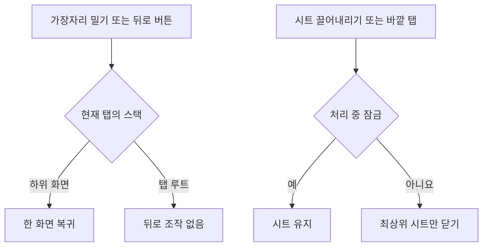
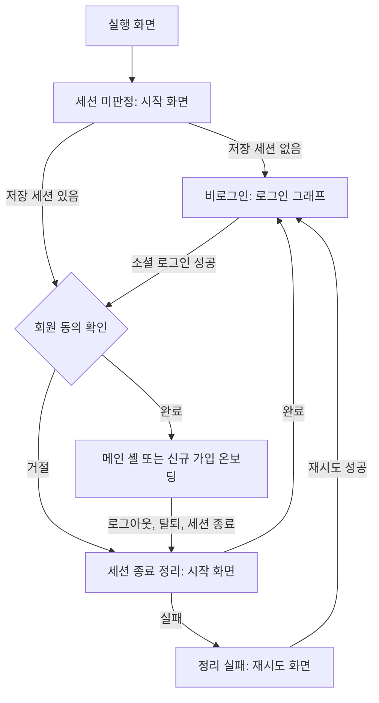
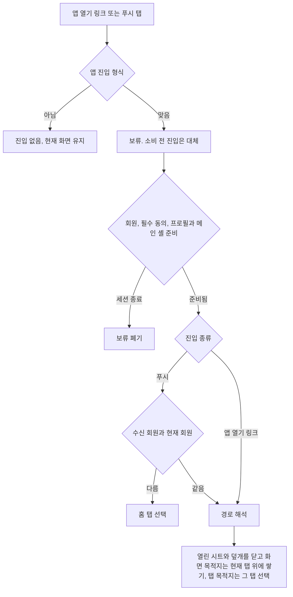

# 3-2 화면 흐름: iOS

기준: [공통 흐름](../3-2-INTERACTION-FLOWS.md), [iOS 화면](3-1-INFORMATION-ARCHITECTURE.md).

 

### 3-2-1 탭과 화면 복귀

| 조작 | 결과 |
|---|---|
| 다른 탭 선택 | 탭 바가 보이는 탭 루트에서만 가능. 옮겨 간 탭의 스택과 스크롤 유지 |
| 선택한 탭 다시 누르기 | 탭 루트에서만 가능하며 변화 없음 |
| 앱이 탭을 바꾸는 이동 | 떠난 탭에 쌓여 있던 하위 화면과 스크롤 유지. 돌아오면 같은 화면 |
| 하위 화면 진입 | 현재 탭 스택에 쌓고 진입과 함께 탭 바를 숨김 |
| 상세 위 채팅 시작 | 같은 탭 스택에 채팅방. 채팅 뒤로가기는 상세, 다시 뒤로가기는 상세를 연 화면 |
| 삭제나 제작 종료로 탭 복귀 | 현재 탭 스택에서 해당 흐름의 화면을 걷어내고 목적 탭의 루트 선택 |
| 옵션에서 삭제 또는 신고 | 옵션 시트가 닫힌 뒤 확인 알림창이나 신고 시트 표시 |
| 시트에서 다른 화면 이동 | 시트를 먼저 닫고 목적 화면으로 이동. 닫힌 시트로 돌아오지 않음 |
| 열린 시트 위 가장자리 밀기 | 아래 화면에 전달하지 않음 |

도메인별 화면 종료와 저장 조건은 각 도메인 흐름을 따른다. 테마나 글자 크기 변경 때문에 화면 이동이나 데이터 요청을 다시 실행하지 않는다.

 

### 3-2-2 루트 교체와 시작

실행 화면(Launch Screen, 앱 코드가 실행되기 전에 시스템이 보여 주는 정적 화면)은 네트워크를 기다리지 않고 앱의 첫 프레임에서 시작 화면으로 바뀐다. 동의 확인 실패와 재시도, 로그인 차단 조건은 ACCOUNT 흐름을 따른다. ([ACCOUNT 로그인과 필수 동의](../../spec/ACCOUNT/CLIENT/3-2-INTERACTION-FLOWS.md#3-2-1-로그인과-필수-동의), [로그아웃과 탈퇴](../../spec/ACCOUNT/CLIENT/3-2-INTERACTION-FLOWS.md#3-2-4-로그아웃과-탈퇴))

루트가 바뀌면 이전 루트의 화면, 탭 스택과 열린 시트를 모두 버리고 전환 애니메이션 없이 교체한다. 다시 로그인한 메인 셸은 홈 탭 루트에서 시작한다.

 

### 3-2-3 외부 진입

진입을 소비할 때 여는 방식은 [진입 목적지](3-1-INFORMATION-ARCHITECTURE.md#3-1-2-진입-목적지)를 따른다. 신규 가입 온보딩이 보이는 동안에는 보류를 유지한다. 온보딩을 마치면 완료 계기가 정한 탭과 스택을 구성한 뒤 보류 진입을 소비한다. 화면 목적지는 완료 계기가 고른 탭의 스택 위에 쌓이고, 탭 목적지는 그 탭을 선택하며 완료 계기가 연 스택은 자기 탭에 남는다. 외부 진입은 이탈 확인 없이 열린 시트를 닫으며 입력 저장 조건은 각 도메인을 따른다. ([I-044](DECISIONS.md#i-044))

앱이 앞에 있을 때 받은 알림의 표시 여부는 NOTIFICATION이 정한다. 이 흐름은 사용자가 알림을 누른 뒤부터 적용한다.

 

### 3-2-4 테마와 복원

테마 변경은 [공통 순서](../3-2-INTERACTION-FLOWS.md#3-2-2-테마)로 순환하고 즉시 모든 화면, 시트, 알림창과 토스트에 적용한다. 시스템 설정을 고르면 이후 시스템 모양 변경을 바로 따른다. 실행 화면은 앱 설정 전에 그려지므로 시스템 모양을 따르며 앱 테마가 다르면 첫 프레임에서 바뀐다.

| 다시 열기 | 시작 화면 |
|---|---|
| 시스템이 백그라운드 앱을 종료한 뒤 | 저장 세션 확인 뒤 마지막 선택 탭의 루트. 다른 탭도 루트 |
| 사용자가 앱 전환기에서 닫은 뒤, 첫 실행, 재설치 | 홈 탭 루트 |
| 외부 진입으로 실행 | 화면 목적지는 복원한 탭(없으면 홈) 루트 위에 쌓음. 탭 목적지는 그 탭이며 복원한 탭보다 우선 |
| 루트가 바뀐 뒤 메인 셸 | 홈 탭 루트 |

탭 스택, 열린 시트와 스크롤 위치는 프로세스 종료 뒤 복원하지 않는다. ([I-032](DECISIONS.md#i-032), [I-045](DECISIONS.md#i-045))
